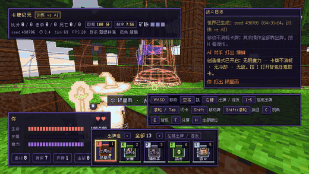
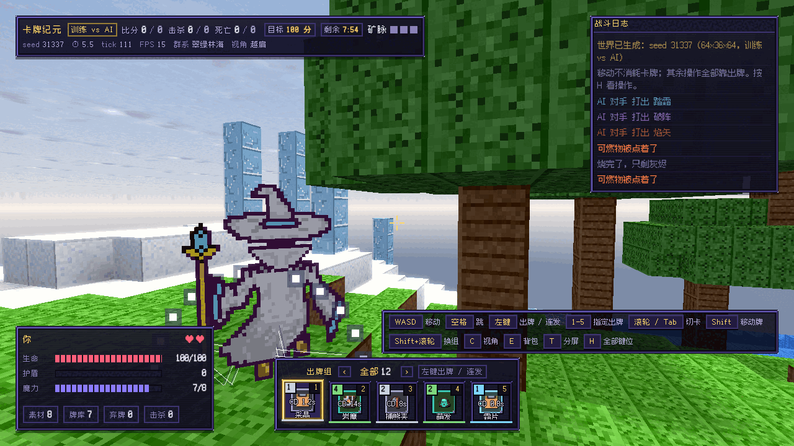
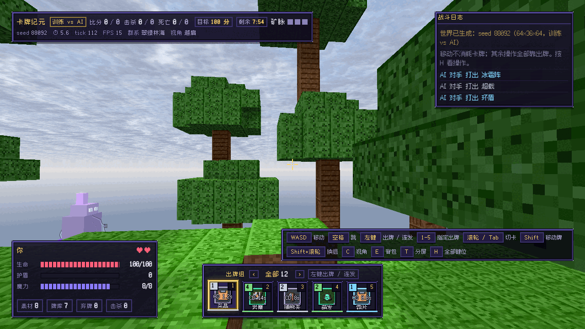
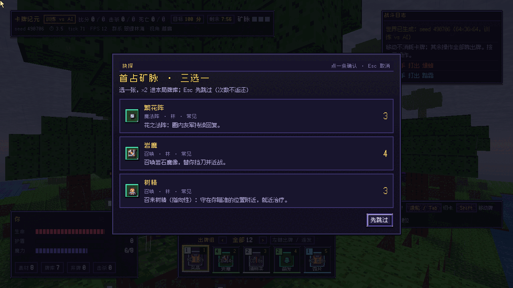
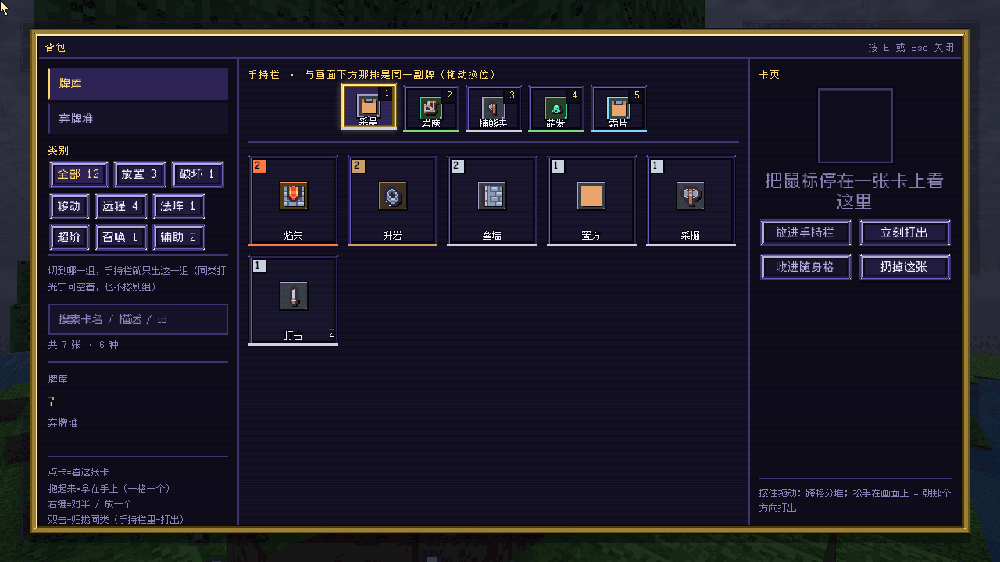
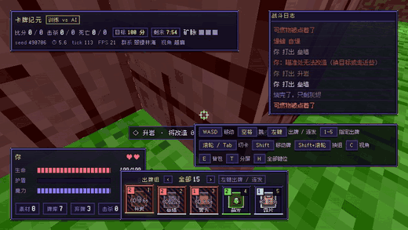
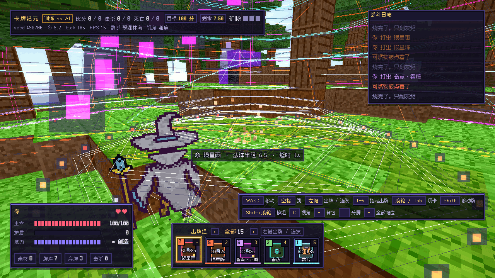

<div align="center">

# 卡牌纪元 · Card Epoch

**像素 3D 体素卡牌对战 —— 卡牌真的会改地形。**
挖坑、砌墙、点火、结冰、召飞、砸陨星；越肩视角，按住左键就能玩。

**零构建、零运行时依赖**：clone 下来双击 `index.html` 就能跑，不用 npm install、不用打包、不用起服务。



[](LICENSE)


-black.svg?style=flat-square)
[](#%E8%81%94%E6%9C%BA%E5%86%85%E7%BD%AE%E6%B5%8F%E8%A7%88%E5%99%A8-webRTC)

English: a **zero-build, dependency-free** voxel card battler that runs from `file://`.
76 cards actually rewrite the voxel world; over-the-shoulder camera; LAN 2-player with a
browser-native WebRTC host. MIT — every third-party asset is CC0 / OFL / CC-BY and credited.

</div>

---

## 30 秒跑起来

```bash
git clone https://github.com/BluedeDove/card-epoch.git && cd card-epoch
open index.html        # macOS；Windows 直接双击 index.html；Linux: xdg-open index.html
```

- 桌面 Chrome / Edge / Firefox，需要 WebGL2 与 Pointer Lock；**file:// 直跑**（本项目所有验收都以这条路径为准）。
- 想走 http：`python3 -m http.server 8000` 然后开 <http://localhost:8000/index.html>。
- 跑回归量具要 Node 18+；会开无头浏览器的那几条再补 `npm i -D playwright && npx playwright install chromium`。

主菜单 → 选关（地图 × 规则 × 玩法）→ 战前选牌 → 开局。默认种子 `490706` 是可复现的：**同一个种子 = 同一张地图，逐格一致**，
截图、报 bug、跟朋友比同一局都可以直接甩种子。

## 你会看到什么

| | |
|---|---|
| <br>*seed 31337 · duel-64：树木、水面、以太晶矿脉，全部由种子推导* | <br>*角色用公告牌（素材原画 4 方向帧）而不是盒模型拼四肢——拼出来的像一堆碎片* |
| <br>*占矿与击杀会排上三选一，池子按生物群系分（林海 / 黄沙 / 雪原 + 通用）* | <br>*生存模式也有物品栏与背包；卡面图标是从 CC0 素材烘焙出来的数据* |

| 卡牌真的改地形：一条卡 = 一串指令，写世界只经结算器 | 超阶卡的演出是分层的，不是糊一团光 |
|---|---|
|  |  |

> 图与动图都是 `node tools/readme_media.cjs` 真跑出来的：对局推进走主循环自己的 20Hz tick，
> 出牌走权威层 `Match.playCard`，与玩家手打的同一条通道（AI 与真人也共用同一条输入通道，没有后门）。
> GIF 的帧率按采集时的实测帧距换算，不是随手写的数字。

## 凭什么值得看一眼

- **76 张卡**：法术 37 / 地形 22 / 法阵 9 / 召唤 7 / 实用 1；稀有度 常见 58 · 罕见 8 · 稀有 10。
- **8 个出牌组**（按「放出来干什么」分）：放置 15 · 破坏 7 · 移动 7 · 远程 17 · 法阵 5 · 超阶 6 · 召唤 6 · 辅助 13。
- **13 座法阵与仪式**：9 座战斗阵 + 超阶仪式的外/中/内三层阵（各 30 血）与主阵（60 血）；三层阵**能被对手的破阵卡拆掉**，拆了核爆就不落地。
- **2 种玩法 × 4 条规则 × 3 张图**：占矿争锋（100 分 / 8 分钟 / 加时 45 秒）、死亡竞赛（10 杀，胜分可设 5 / 10 / 不限）；
- **网页双人**：浏览器内置 WebRTC，房主权威；邀请码/回应码配对，不需要另起 Node 服务端，协议版本闸（v4）仍在。
- **物质交互**：火 / 熔 / 冻 / 凝 / 灭九条反应，常驻激活集只装「自己会变」的格子，**绝不整图扫描**，每 tick 有硬预算与熔断。
- **手感是被量化过的**：逻辑 20Hz tick，但渲染读插值位置 —— 同窗口对照实测零位移渲染帧 66.5% → **0.8%**，单帧最大÷平均 3.23 → **1.1**。
- **声音零素材**：31 条运行时音效事件由振荡器现场合成，3 段 BGM + 22 条 wav 由 `tools/music_compose.cjs` 离线渲染（wav 不入库，逐位可重建）。
- **规模**：`src/` 21,689 行 JS（102 个文件，无打包无构建）· `tools/` 14,121 行 / 60+ 个 `.cjs` 脚本。

## 操作

| 按键 | 做什么 |
|---|---|
| <kbd>W</kbd><kbd>A</kbd><kbd>S</kbd><kbd>D</kbd> / <kbd>Space</kbd> | 移动 / 跳（含 coyote 0.12s 与输入缓冲 0.20s） |
| 鼠标 | 转向 —— **只有鼠标能转身**（Minecraft 式，锁定指针后）；<kbd>F</kbd>/<kbd>V</kbd> 俯仰兜底 |
| <kbd>左键</kbd> | 按住 = 默认攻击牌组自动连发 |
| <kbd>右键</kbd> | 打出当前物品栏选中的那一格（放置/破坏/移动/辅助也走右键） |
| <kbd>1</kbd>–<kbd>5</kbd> / <kbd>滚轮</kbd> / <kbd>Tab</kbd> | 指定出牌 / 切卡 / 换卡 |
| <kbd>Shift</kbd> | 触发移动牌（移动组全员 Shift 快捷）；<kbd>Shift</kbd>+<kbd>滚轮</kbd> 换出牌组 |
| <kbd>E</kbd> | 背包与物品栏（生存模式也有）；<kbd>C</kbd> 视角 · <kbd>H</kbd> 键位带 · <kbd>P</kbd> 光影 |
| <kbd>G</kbd> | 创造调试模式（给卡 / 飞行 / 穿墙）—— **测试脚手架，不是产品特性** |

## 联机（内置浏览器 WebRTC，房主权威）

不需要 Node、不需要 WebSocket 服务端。两端都双击同一份 `index.html`，选关里模式选「网页联机（房主 / 加入）」：

1. **房主**：角色选「创建房主」→ 点开始 → 生成**邀请码**，复制给对手。
2. **加入者**：角色选「加入对局」→ 粘贴邀请码 → 点开始 → 生成**回应码**，复制回房主。
3. **房主**：把回应码粘进「回应码」框 → 点「完成连接」。
4. 两端进入战前选牌，各选 12 张（单卡 ≤2、地形 ≥4），双方就绪后由房主开局。

房主页面内跑一个房内 Relay（hello/joined/peer-joined 与 input/snapshot/event 路由），
guest 端是 1↔0 镜像 + 快照外推，**对方手牌内容与双方牌库顺序不出门**（序列化白名单）。
同一台机器可双开自测：两个标签页分别当房主/加入者，手动交换邀请码即可。
默认只带 ICE 主机候选，适合同一局域网；跨 NAT 需要自备 TURN。口径见 [docs/NET.md](docs/NET.md)。

## 仓库结构

| 位置 | 是什么 |
|---|---|
| [`index.html`](index.html) | 唯一入口：只有挂载点与一个样式表链接，不含逻辑与文案 |
| [`src/`](src/) | 全部源码（无构建，按脚本顺序加载）：`world` 体素存储 / `battle` 权威推进 / `rules` 结算 |
| [`src/cards.js`](src/cards.js) · [`src/rules.js`](src/rules.js) + [`src/rules/effects/`](src/rules/effects/) | 纯数据（76 卡 / 13 阵 / 初始牌库）与结算指令 |
| [`src/camera.js`](src/camera.js) · [`src/hero-rig.js`](src/hero-rig.js) | 越肩与第一人称相机（target-domain 单一方程伺服）/ 角色模型与四条动画时间线 |
| [`src/ui/`](src/ui/) · [`src/hud.js`](src/hud.js) | 视图框架（声明式 spec + 图层顺序 + 意图通道）/ 全项目**唯一**文案表 `H.TEXT` |
| [`src/chem.js`](src/chem.js) · [`src/vfx.js`](src/vfx.js) · [`src/audio.js`](src/audio.js) · [`src/shader.js`](src/shader.js) | 物质反应 / 特效（原子→配方→渲染）/ 音频（引擎→配方→门面）/ 后处理光影 |
| [`src/net*.js`](src/net-ws.js) · [`src/net-rtc.js`](src/net-rtc.js) | 联机：WebRTC 房主/加入者 + 房内 Relay + 同步纯逻辑（白名单序列化）；`tools/net_host.cjs` 仅保留为协议回归 |
| [`src/app/`](src/app/) | 路由、场景、玩法编排、规则与地图预设、装配层 |
| [`vendor/`](vendor/) | three.js r128（MIT，文件头带 SPDX），**没有任何 CDN 外链** |
| [`docs/`](docs/) | 现行口径（NET / UI_DESIGN / FX_ATOMS / LEVELS / MODES / ROUTER…）、`archive/` 历史归档、素材出处 |
| [`tools/`](tools/) | 60+ 个 `.cjs` 脚本：验收量具、素材烘焙、打包导出（**本项目最值钱的部分之一**） |
| [DEVLOG.md](DEVLOG.md) | 十五轮开发日志：每轮的量化验收与踩坑 |

## 工程口径：每条不变量都有一个量具守着

文档会被忘掉，机检不会。改完东西按「动了哪层」跑对应脚本：

```bash
node tools/audit.cjs                # 相机/战斗/世界：三种子 × 15 项；--file 走双击真路径；--shots 落构图
node tools/layer_check.cjs          # 分层责任制：逻辑层碰 DOM / 写死玩家可见文案 / 反向依赖 → 非零退出
node tools/ui_check.cjs             # UI 框架：堆叠代数 + 静态分层 + 真页面冒烟 + 玩家真实动作
node tools/bag_flow_check.cjs       # 背包/手牌：hand+deck+discard 的多重集必须守恒（不造牌、不吞牌）
node tools/cards_probe.cjs          # 卡牌机制：墙站得住 / 飞桥铺板 / 陨星砸坑 / 仪式可打断 / 黑洞拽近
node tools/hit_check.cjs            # 判定：偏 0.9~1.3 格必须掉血、偏 2.6 格必须不掉、单发伤害区间
node tools/chem_check.cjs           # 物质反应：九条逐格核最终方块 + 稳态必须零成本 + 单 tick 预算与熔断
node tools/net_e2e.cjs              # 旧 Node 服务端路径：两端真跑一局 E1–E10（跑它时别并行跑别的量具）
node tools/net_rtc_check.cjs        # 浏览器内置 WebRTC：邀请码/回应码 → 双端 loadout → 双端 match/tick
```

<details><summary>四条永远不许退回去的不变量（点开看）</summary>

1. **准星 = 命中格**：`cam.dir` 与 `aimOrigin` 从 `lookAt` 之后的相机真实朝向反推；构图偏移一律通过相机位置/lookAt 表达，
   绝不在别处再算一份 `fwd` 当瞄准方向（两套数一分开，准星压 A 格、命中的就是 B 格）。
2. **画在哪 ≠ 在哪**：判定、命中、存档一律读 `e.pos`；网格与相机读插值位置，**插值永不写回权威状态**。
3. **机位约束不能是逐帧二值开关**：约束只写目标、位移只出自伺服；开关翻转本身就是要平滑的量。
4. **每层只写自己那层的信息**：逻辑层零 DOM、零玩家可见文案；玩家可见中文只允许出现在 `src/hud.js` 的 `H.TEXT`。

完整的「改哪层 → 必跑哪条」表与全部不变量在 [AGENTS.md](AGENTS.md)。

</details>

<details><summary>这些素材与动图是怎么来的</summary>

```bash
node tools/hero_bake.cjs            # 从 CC-BY 法师素材烘焙出 src/hero-sprites.js（纯数据表）
node tools/make_card_icons.cjs      # 从 CC0 素材烘焙卡面图标 src/ui/card-icons.js
node tools/music_compose.cjs all    # 离线渲染 3 段 BGM + 22 条音效 wav（不入库）
node tools/readme_media.cjs         # 重采 README 里的静图与 GIF（同一批机位，可复现）
node tools/export_pack.cjs          # 出一个可直接双击的可玩包
```

</details>

## 第三方素材与许可

代码是 MIT；下面这些**不是本项目写的**（明细见 [LICENSE-THIRD-PARTY.md](LICENSE-THIRD-PARTY.md)）：

| 素材 | 作者 / 来源 | 许可 |
|---|---|---|
| three.js r128 | [Three.js Authors](https://threejs.org/) | MIT（`vendor/three.min.js` 文件头带 SPDX） |
| Wizard sprite sheet（玩家角色） | [movicx @ OpenGameArt](https://opengameart.org/content/wizard-sprite-sheet) | **CC-BY 3.0 —— 再分发须保留署名行** |
| UI Pack - Pixel Adventure / Pixel UI Pack / Tiny Dungeon | [Kenney](https://kenney.nl/) | CC0（包内 `License.txt` 一并分发） |
| Fusion Pixel Font 12px（全部中文字形） | [TakWolf](https://github.com/TakWolf/fusion-pixel-font) | SIL OFL 1.1（`assets/fonts/OFL.txt` 全文随包） |

再分发（含打包 zip、截图、视频）请保留：**像素素材：Wizard sprite sheet · movicx（CC-BY 3.0）**

当初收集的法阵 / Noita 模组 / Minecraft 模组参考图版权归原站，**不随本仓库分发**，只留出处：
[docs/RESEARCH_SOURCES.md](docs/RESEARCH_SOURCES.md)。音乐与音效没有任何第三方素材，全部代码合成。

## 已知限制（如实，别当成 bug 报）

- **联机是浏览器 WebRTC + 手动邀请码**：默认只带 ICE 主机候选，适合同一局域网/同一台机器；不做公网中继/自动发现/账号匹配/防作弊，跨 NAT 需自备 TURN。
- **存档 = seed + 与基线的差异格**：不存实体位置与法阵，重开一局就没了。
- **自动化环境是 SwiftShader 软件光栅**（约 50 FPS）：那里的帧率数字不能当真机指标；手感类结论需要真机复核，
  渲染验证也只跑过 1440×860@dpr1 与 1280×720@dpr1.5 两档 —— 移动端、触屏、手柄都没做。
- `island-96` / `atoll-128` 标着**实验性**：矿脉可达性闸放宽了，公平分只作参考。
- 卡面与角色是像素素材 + 程序烘焙，不是美术团队产物；配色口径见 [docs/UI_DESIGN.md](docs/UI_DESIGN.md)。
- README 里的量化数字来自代码与量具实测；文中「N 条」只是那条断言在管什么的简写，**真实条数与红绿一律以脚本输出为准**。
- 提交历史是从零开始的一次快照（脱敏与版权隔离由导出脚本负责），完整开发过程看 [DEVLOG.md](DEVLOG.md)。

## 想搭把手的话

- [ ] 公网联机：自动信令 + TURN/中转（协议 v4 与房内 Relay 已经在那儿了）
- [ ] 存档扩展：实体与法阵状态（`src/save.js` 现在只存 seed + 差异格）
- [ ] 游戏内署名行：把 CC-BY 署名接进 HUD 的「关于/帮助」（现在只登记在许可表里）
- [ ] 两张实验地图的矿脉公平性（`tools/lode_scale_check.cjs` 的判据可以先加严）
- [ ] 触屏 / 手柄输入
- [ ] `docs/archive/` 里那批历史文档的死链清理（旧 `js/` 路径没跟上 2026-10-17 的迁移）

改动前请先读 [AGENTS.md](AGENTS.md)（真源在哪、怎么验、改之前必须知道的不变量），并按那张「改哪层 → 必跑哪条」表跑门禁。

## License

- 代码：[MIT](LICENSE)
- 第三方素材与署名要求：[LICENSE-THIRD-PARTY.md](LICENSE-THIRD-PARTY.md)

> Noita 是 Nolla Games 的商标。本项目是同类型（体素 + 卡牌施法）的独立实现，不含 Noita 的任何代码或资产。
