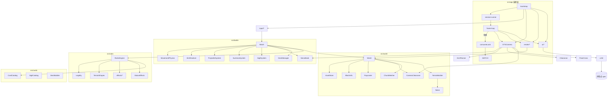

# 重构方案 · 卡牌纪元（**未开工，等指令**）

> 状态（2026-10-16 17:05 复核）：本轮**只做了勘察**，`js/` 与 `index.html` 一个字都没改。
> 另一会话 16:58–17:00 连改三处：[js/camera.js](js/camera.js)（位置域限流 → 半径/侧移/托举三通道二阶伺服）、
> [tools/cam_audit.js](tools/cam_audit.js)（J 项改成量 jerk + 60/160/240 三帧率）、README。§2/§4.6/§8/§9 已按最新代码重算。
> 本方案 **P4 之前不动 camera.js**，避免覆盖那边的成果。
>
> 批准后按 §9 分阶段执行，每阶段都有可判定验收；baseline 数字见 §9 P0。

---

## 1. 目标（对应你提的四条要求）

| 你的要求 | 落地成可判定的形态 |
|---|---|
| 拆成多个文件夹、多个类 | `src/<层>/<概念>.js`，一个概念一个类，**100 个文件**（同层可机械合并到 ~80；现在 10 个），每层一个索引注释 |
| 类之间关系梳理清楚 | **11 层**只允许向下依赖；跨层装配只在 `src/app/bootstrap.js`；rules→Match 的 15 个回调具名成 **MatchOps**；`ARCHITECTURE.md` 一张图 + §5.3 mermaid |
| 单一职责 | 一个类只回答一个问题（见 §5.2 每行"职责一句话"），并配 §4.1 违规清单逐条消除 |
| 功能函数 ≤3 行 | 机检：`node tools/lint_lines.cjs src/` 必须 0 违规（规则见 §6） |
| UI 声明式、语义清晰、别藏几层 | `src/ui/` 全部用数据 spec 描述面板与绑定；§7 给 before/after；§4.3 点名现在藏起来的东西 |

一条硬约束贯穿全程：**行为不变、验收数字不退化**（§8 契约 + 数值冻结表），发现的真 bug 单独立项（§4.5），不夹在重构里偷偷改。

---

## 2. 实测现状

`js/` 共 10 文件 3420 行、261 个函数（按大括号配平统计，注释与空行不计）。

| 文件 | 行 | 函数 | >3 行 | >6 行 | >15 行 | 最长的三个 |
|---|---|---|---|---|---|---|
| main.js | 966 | 66 | 43 | 32 | 10 | syncEntities 108L、buildChunkGeometry 46L、start 46L |
| battle.js | 585 | 50 | 35 | 24 | 11 | stepSummons 51L、collideAABB 44L、stepProjectiles 31L |
| world.js | 509 | 36 | 24 | 15 | 7 | buildAtlas 104L、generate 53L、fillTile 48L |
| camera.js | **447** | 12 | 7 | 5 | 2 | **update 190L**、构造 53L、boxHitsCross 14L |
| rules.js | 330 | 11 | 9 | 7 | 4 | **applyEffect 101L**、cellsFor 76L、tick 47L |
| hud.js | 218 | 28 | 10 | 9 | 4 | art 39L、init 31L、renderHands 26L |
| net.js | 175 | 10 | 7 | 5 | 2 | AISource.poll 40L、构造 24L、flushLook 12L |
| save.js | 58 | 9 | 5 | 3 | 0 | diffCells 11L、exportFrom 8L、applyTo 7L |
| cards.js | 130 | 7 | 1 | 1 | 0 | C 12L（注册器） |
| audio.js | 62 | 24 | 3 | 2 | 0 | tone 9L、noise 8L |

**约一半函数超过 3 行，15% 超过 15 行。** 六个"巨石函数"是重构的主要工作量：`camera.update`(190，16:58 伺服版)、`main.syncEntities`(108)、`world.buildAtlas`(104)、`rules.applyEffect`(101)、`rules.cellsFor`(76)、`battle.stepSummons`(51)。

活代码实测验收（17:02，seed 490706 / starter / train，含 16:58 的伺服改造）：**14/15 pass**，唯一 fail 仍是 J：`@60 静立 0 / 转视角位移 0.6249、jerk 1449`，`@160 转视角 0.19、jerk 2283.9`，`@240 转视角 0.1181、jerk 2258.3`，点级穿透 114/15456 帧（全在转视角期），让路 19 次，自检违例 0。

## 3. 实测依赖（grep 出来的，不是我猜的）

| 谁 | 引用了哪些全局符号 |
|---|---|
| main.js | World Match Rules HUD Audio Save Net OTSCamera BLOCK BLOCK_DEFS FACES CHUNK CARDS CARDS_BY_ID ELEMENTS SIGILS STARTER_DECK CAM_MODES（**18 个**） |
| battle.js | Rules World BLOCK BLOCK_DEFS CARDS_BY_ID ELEMENTS SIGILS STARTER_DECK |
| hud.js | Audio Rules CARDS CARDS_BY_ID ELEMENTS SIGILS TYPE_CN RARITY_CN |
| rules.js | BLOCK BLOCK_DEFS ELEMENTS |
| net.js | BLOCK CARDS_BY_ID Rules |
| camera.js | BLOCK（**只此一个**，可整块搬走） |
| world / cards / audio / save | 无外部依赖（干净的地基层） |

三个结论：

1. **main.js 是上帝文件**：装配、体素烘焙、角色模型、粒子、飘字、法阵贴图、昼夜、瞄准、输入绑定、渲染、存档 UI 全在里面（18 个依赖 + 619 处字面量 + 77 个 `new THREE.`）。
2. **hud.js 不只是 UI**：它查规则（`G.Rules.canPlay`）、放音效（`G.Audio`）、持有出牌回调，UI 与结算逻辑互相回调。
3. **双向依赖有两条**：`battle ↔ rules`（经 `ctx.match`，可保留但要显式注入）与 `main ↔ hud`（`fx` 回调 + `handlers` 回调，见 §4.3 的出牌双调用）。

---

## 4. 违规清单（重构要逐条消除的东西）

### 4.1 单一职责被打破的位置

| 位置 | 问题 | 去处 |
|---|---|---|
| [js/world.js](js/world.js) `buildAtlas` 104L | 体素存储文件里画像素贴图（canvas 2D + 调色 + 每种方块的画法分支） | `render/atlas/`，每种方块一个 painter |
| js/world.js `geometryForChunk` 43L | 与 main.js 的 `buildChunkGeometry` 是**两份**烘焙实现（一份没人调） | 合到 `world/chunk-mesher.js` 一份，见 §4.4 |
| js/world.js `generate` 53L | 高度图、群系、填色、矿脉、植树挤在一个方法 | `terrain-builder.js` + `prop-planter.js` |
| js/main.js `syncEntities` 108L | 主角摆姿势、名牌、随从、抛射物池、法阵、目标框、改造预览、准星文案 | 拆成 7 个 view（`render/`） |
| js/main.js `start` 46L | 建世界、建牌库、建对局、建相机、建输入、布局、提示、日志 | `app/session-runner.js` 逐步委托 |
| js/rules.js `applyEffect` 101L | 20 个 op 的 if/switch 长链，里面还混着粒子与音效调用 | `rules/effects/<op>.js` 每个 op 一个 handler，fx 走注入 |
| js/rules.js `cellsFor` 76L | 10 种地形形态 + 去重 + 上限 + 占位检查混在一起 | `rules/terrain-shapes.js`（表）+ `rules/cell-collector.js`（规则） |
| js/hud.js `init` 31L | 取 DOM、绑 9 个按钮、绑两个按钮组、写 spec、隐藏 HUD | `ui/` 各 view 自己声明，装配点统一绑 |
| js/battle.js `Match.step` 里的 `stepSummons` 51L | 索敌、追击、近战、治疗、逃命、跳跃、重力全在一个循环 | `battle/summon-system.js` + `battle/summon-behaviors.js`（ai 表驱动） |
| js/main.js `dayNight` | 渲染层直接读 `match.dayT`/`world.biomeAt` | `render/scene-env.js` 只接"时刻+群系"两个入参 |

### 4.2 超过 3 行的函数：机检基线 **135 个**（`node tools/lint_lines.cjs js`，口径统一到此工具），全部要拆（规则与工具见 §6）

### 4.3 "藏了好几层、看不清谁在干什么"（你说的那个问题的实底）

| # | 藏起来的东西 | 位置 | 说明 |
|---|---|---|---|
| 1 | 空转的 monkey-patch | js/main.js:153 `patchWorldDirty` | 把 `world.set` 包一层，函数体只有 `return orig(...)`，什么都没做；删 |
| 2 | 第二时间线 | js/main.js `setInterval(autoFacePatch, 33)` | 主循环之外每 33ms 直接改 P2 的 `yaw`，绕开 `applyLook`；AGENTS.md 已警告过混时间线的代价 → 并回 `frame()`，交给 `SplitAutoFace` 意图对象 |
| 3 | 出牌链路绕两层且**双触发**（已实测） | js/hud.js:161 → js/main.js:368 → js/main.js:417；另有 js/main.js:910-913 | 点一张卡的 onclick 同帧既调 match.fx.requestCast(side,i)（→ castCard）又调 H.cast(side,i)（→ handlers.cast → castCard）。运行时实测：一次 click → playCard 调用 2 次、索引都是 0，手牌 [heal,shard,raise,bolt,draw1] → [raise,bolt,draw1,wall2,dig3]，弃牌 0→2，魔力 10→7。中间还夹一句空语句 if (match.playCard) {} |
| 4 | 靠字符串拼出来的 12 个 DOM id | js/hud.js `setW('ui-hp'+pre)` | `ui-hp/ui-hpt/ui-sh/ui-sht/ui-mn/ui-mnt/ui-mat/ui-dk/ui-ds/ui-k/ui-n/ui-l` + 手号，只有 `index.html` 与两处拼接约定一致才找得到，改一处就静默失效 |
| 5 | 第二个 `id="cross"` 节点 | js/hud.js `setSplit` | 分屏时克隆出**重复 id** 的准星（HTML id 必须唯一），靠 `style.left` 区分；声明式化后是两个独立节点 |
| 6 | 出牌入口有三个 | poll 的 `cast`、数字键、点卡 | 收敛到"选牌意图"一个入口，其余只是产生同一意图的不同来源 |
| 7 | `G.Save.localLoadSafe = G.Save.localLoad` | js/main.js:963 | 只在 main 里加的别名，两个名字一件事 |

### 4.4 重复实现与死代码（**要确认后删**）

- 重复：`World.geometryForChunk`(43L) ↔ `main.buildChunkGeometry`(46L)，只有后者在用。
- 未被调用：`World.lineBlocked`、`World.restoreBaseline`、`G.OrbitCamera`（菜单相机是手摆的）、`G.PHYS`/`REACH`、`fx.float`、`G.RARITY_WEIGHT`、`G.isSolidId`/`isOpaqueId`、`World.getDef`（仅内部）、`G.CAM_MODE_CN`（HUD 用 `modeName()`）。
- 建议：死代码直接不进新结构；确有回归价值的保留在 `tools/` 里由脚本调用。

### 4.5 顺手发现的真 bug（**不在重构里悄悄改**）

| # | 现象 | 证据 | 处理建议 |
|---|---|---|---|
| B1 | "图腾"卡的图腾从不生效 | [js/battle.js](js/battle.js) `addSigil` 里 `presetId='totem'`，但 `G.SIGILS` 没有 `totem` 键；回退 `G.SIGILS[card.id]` 也不存在 → `return null`，`sigilTick` 里的 `preset.id==='totem'` 分支永远进不去 | 重构**保持现状**；补 `SIGILS.totem` 是行为变更，单独提一次 |
| B2 | **点一张卡打出两张、扣两次魔力**（17:12 运行时实测） | 一次 `card.click()` 使 `playCard` 被调 2 次、索引都是 0：手牌 `[heal,shard,raise,bolt,draw1]` → `[raise,bolt,draw1,wall2,dig3]`，弃牌 0→2，魔力 10→7（heal 2 + shard 1） | 根因即 §4.3 第 3 条的双回调；**是既有 bug 不是重构副产物**，单独一次改，并加点击回归用例 |

这两条我会先写用例固定住，不与重构混在同一批改动里。

### 4.6 验收脚本与伺服相机的接口已经对不上（17:03 实测，进 P4 前置）

伺服改造把"状态"收进了三条通道（`rCh/lCh/fCh`），但`tools/cam_audit.js` 还在按旧接口**直接写**机位量：

| 现象 | 证据（实测） | 后果 |
|---|---|---|
| 外部写 `cam.curRadius` 不再改变机位 | 探针：写 `curRadius=1.0` 后连续 `update` 两次，读回仍是 **3.55**（= `rCh.x`，被伺服覆盖） | cam_audit:257（D 项重置半径）与 :522（`__camPose` 的 `curRadius` 参数）**已成空操作**：D 项靠后面 8 帧静置侥幸不受影响，`__camPose` 的截图调参入口失效 |
| 外部写 `cam.curRadius` 仍影响"平地"分类 | cam_audit:203/214 用 `cam.curRadius > cam.radius * 0.9` 统计 C3 平地样本 | 读的是伺服镜像，暂时正确；但它是**只读镜像**，谁哪天再写它就静默失真 |
| 相机自检字段成了验收依赖 | cam_audit:420/489/490 读 `posViolations`、`hardUnstick` | 这两个字段必须继续是 `OTSCamera` 实例上的直字段（已并入 §8 契约） |

修法（评审 B 已定）：`OTSCamera` 增加显式测试入口，**成对更新状态与镜像**（js/camera.js:308-309 平时就是成对写的，测试入口不能只写一半）：

    setRadiusForTest(r) {
      this.rCh.x = r; this.rCh.v = 0;
      this.curRadius = r;
      this.tooClose = (this.radius - r) > (this.radius - this.tightRadius + 0.15);
    }

cam_audit 的两处写点（cam_audit.js:257 的 D 项、:522 的 `__camPose`）改调它，**不要让验收脚本直接捅 `rCh`**——通道结构再变时只动一处。这是 §9 门禁里唯一允许改动 cam_audit 的地方。**重构不许顺手删这条硬钳通道**：它是 J 项能测出埋墙的前提。

---

## 5. 目标架构

### 5.1 分层（只允许向下依赖；ARCHITECTURE.md 里同一张图）

> 层号 0–10 共 11 层（评审 D5 指出"十层"说法与表不符，已改正）。

| # | 层 / 目录 | 回答的唯一问题 | 允许依赖 |
|---|---|---|---|
| 0 | src/core/ | 随机、向量、噪声怎么算 | 无 |
| 1 | src/world/ | 世界有哪些格、格是什么、能不能穿、某块几何长什么样 | core |
| 2 | src/cards/ | 有哪些卡、卡由哪些效果组成（纯数据） | core |
| 3 | src/rules/ | 这张牌能不能出、出下去产生哪些格子与状态（无 THREE、无 DOM） | cards, world, core + **MatchOps 接口** |
| 4 | src/battle/ | 权威 tick：实体、物理、瞄准、抛射物、随从、法阵、流体、胜负 | rules, world, core |
| 5 | src/camera/ | 机位在哪、看到什么、瞄准射线是哪条 | world, core |
| 6 | src/input/ | 这一帧每个玩家想做什么（键盘/AI/远端 → 同一种指令流） | battle(仅 MatchOps), cards, world |
| 7 | src/render/ | 把状态画成画面与特效 | battle, world, camera, core, THREE |
| 8 | src/ui/ | 面板/手牌/菜单/结算长什么样（声明式） | viewmodel, cards, core, DOM |
| 9 | src/audio/ src/save/ | 听见什么 / 存下什么 | cards, world, core |
| 10 | src/app/ | 把上面全部装配起来并按帧驱动（唯一**跨层**装配点） | 全部 |

**rules → battle 的运行时回调必须显式命名（评审 D5）**。rules 静态不 import battle，但出牌结算要反向调用 15 个 Match 方法（js/rules.js 实测：all / defaultAim / drawCards / explode / findStanding / fireProjectile / fluidStep / sigilAt / sigilTick / spawnHail / spawnSummon / targetsInRadius / aimEntity / addSigil / ctx.match.kill）。这 15 个方法构成一个具名接口 **MatchOps**，在 src/battle/match-ops.js 里声明（一份方法清单 + 每个方法的一句话契约），Match 实现它、RulesEngine 只依赖它的类型：

- P3 拆 rules 时逐条对账：15 个调用点必须全部落在 MatchOps 里，出现第 16 个就是新依赖，需评审。
- 禁止 rules 直接读 match 的私有字段（如 this.players 数组结构），只能通过 MatchOps 拿实体。

**ui 不查规则（评审 D5 的二选一，这里定了）**：hand-dock 需要的"这张牌能不能出"由 app 层算好塞进 viewmodel（现在 js/hud.js:150 直接调 G.Rules.canPlay，属越层）。ui 层允许读的东西只有：viewmodel、cards 的展示字段（名字/文案/稀有度/流派配色）、core。

禁止事项：rules/battle 里出现 THREE 或 document；ui 直接改世界数据；下层 new 上层；任何类自己去 document.getElementById 找别人的节点（节点只能来自 ui-kit 建出的 spec）。

### 5.2 文件与类清单（逐层点数，合计 **104** 个文件）

> 评审 D4：原"约 60"与逐条实列不符（实际 115）。这里按评审必答 C 收敛：camera 14→6、effects 分档、render 合两对，并把点数写成表，**加总必须等于声明值**。

| 层 | 文件数 | 清单（类名与职责见下方分层细则） |
|---|---|---|
| core | 4 | random(Random) noise(Noise) vector3(V) namespace(GW + require 校验) |
| world | 13 | block-table block-info voxel-store height-query camera-clearance arena-bounds raycaster terrain-builder prop-planter spawn-locator face-table chunk-mesher **world**(World facade) |
| render/atlas | 2 | pixel-atlas(PixelAtlas) atlas-painters(16 个 painter，表驱动) |
| cards | 5 | elements card-catalog sigil-catalog deck-presets deck-builder |
| rules | 21 | legality terrain-shapes cell-collector status-effects damage-resolver fire-spread **rules-engine**(类 + GW.Rules 门面同文件) + effects/basic.js(9 个纯赋值 op 合并) + effects/ 13 个真逻辑 op 各一件 |
| battle | 13 | entity **match-ops**(MatchOps 方法清单) deck-manager movement-physics aim-resolver projectile-system summon-system summon-behaviors sigil-system sigil-outcomes fluid-system scoreboard + match(Match facade) → 13 件 |
| camera | 6 | camera-tuning servo-bank arm-planner clearance pose-cross **ots-camera**(rigs 与门面同文件，持 §8 全部字段) |
| input | 6 | input-frame look-rates keyboard-source ai-source ai-brain remote-source（对外仍挂 GW.Net） |
| render | 12 | render-factory scene-env chunk-view avatar-model avatar-view name-tag summon-model projectile-view sigil-view(模型+贴图合并) particle-field(含飘字 float-text) aim-preview fx-bridge |
| ui | 11 | ui-kit ui-tree top-bar vitals-panel hand-dock card-art log-feed cross-hair toast menu-screen result-screen |
| audio | 3 | audio-engine sfx-table audio |
| save | 2 | save-format save-store |
| app | 6 | app-state session-runner frame-loop hotkeys pointer-input bootstrap |

合计 4+13+2+5+21+13+6+6+12+11+3+2+6 = **104**（逐行"文件数"与清单实列已核对一致；rules 的门面不再单列文件，camera 的 rigs 并进门面文件）。评审 D4 说"要么 ~55 要么如实写"，这里如实写 **104 件**，并给出可执行的合并策略：每层一个索引注释（该层文件头统一写"依赖：X, Y"），加 ARCHITECTURE.md 一张图；**文件多不是藏，命名不清才是藏**——每条职责一句话说得清、且不需要跨文件跳转才能读懂一个方法在干什么，才算合格。若你更看重"打开项目别太多文件"，同层内可再合并（如 effects/basic 之外再并 3 个轻 handler、camera 的 rigs 并入 ots-camera），可降到 ~80，属纯机械操作、不改行为。

> 订正说明（Kimi 二轮第 1 条）：原表三处数字不一致（标题 78 / 加总 100 / 实列 105）。已按清单机械重数为 **104**；rules 与 camera 各并掉一个可合并的文件名。

**camera 六件的职责（按数据流相位切，不按行段；评审 C1）**

| 文件 | 唯一职责 | 为什么在一起 |
|---|---|---|
| camera-tuning.js | 全部阈值具名：fov 70/74/80、radius 2.95、tightRadius 1.25、shoulder 1.55、eyeH 0.62、ballR 0.35、smoothYaw 26、vRelease 4 / vYield 60 / accel 1200 / vSide 20 / accelSide 300 / vLift 20 / vDrop 6、前瞻 LEAD 0.22 / 6 步、准星禁飞区 | 数值集中，P4 之后调参只动这一页 |
| servo-bank.js | rCh/lCh/fCh 三条二阶通道 + servo 积分 + snap()（现 snapToTarget） | 通道与它的积分器是一体，拆开只剩参数传递仪式 |
| arm-planner.js | 从"目标构型 eye"算 wantR：球扫掠 + 当前 lCh 取 min + 角速度前瞻 + 换肩比较 | 这四步共享 latOf/collapseOf/sphere/eyeF 同一套闭包（js/camera.js:226-241, 250-293），拆开就要把闭包上下文当构造参数传来传去 |
| clearance.js | 地面托举二分求 λ + 两级让路（球级写目标 / 点级真穿墙才瞬钳） | 都是"这个位置能不能待"的判定，共享 sphere 与 yieldTo（js/camera.js:317-381） |
| pose-cross.js | 位姿纯函数出口 pos = F(eyeBase, yaw, pitch, rCh.x, lCh.x, fCh.x) + 部件 AABB 是否压准星（boxHitsCross/groupHitsCross） | 两者都只吃"最终构型"，输出几何判定 |
| rigs + ots-camera.js | 编排上面四件；门面持有 §8 列出的全部实例字段与 update(e, world, dt, groups) 签名 | 状态只有一个家 |

> **相机不变量（Kimi 二轮第 2 条订正，与 camera.js:217/:371-381 逐行对齐）**：① cam.pos 永远由 pose-cross 从构型算出，别的代码不许搬 cam.pos；② 对 rCh/lCh/fCh **状态**的写入只允许两处代码位置——servo-bank（伺服积分、snap、teleport 落位，camera.js:93-100/297-305/334）与 clearance（点级真穿墙硬钳，直写 rCh.x，camera.js:371-381）；③ arm-planner 只产出 wantR / wantLat / wantLift **目标值**，不碰通道；④ 任何新代码不得新增第三处通道写入。原方案把"arm-planner 写 wantR"列成第三处写入是自相矛盾的表述，已改。硬钳通道不许删——它是 J 项能测出埋墙的前提。

**rules 的 effects 分档（评审 C2）**：js/rules.js:144-241 的 applyEffect 实有 22 个 case。其中 9 个是 1–2 行赋值（heal / shield / gainMana / manaCapDown / draw / loseHp / buffNext / speed / regen）→ 合并进 effects/basic.js 一张表；其余 13 个有真实逻辑（setBlock / damage / status / spawn / sigil / push / blink / ignite / hail / harvest / destroySigil / swap / totem）各一件，每件 ≤3 行 + 委托。

**ui-tree 不许手抄（评审 C5）**：index.html 现有 65 个 id / 25 个 class，手写转抄本身就是出错源（分屏那个重复 id="cross" 就是手写派生）。P1 先写 tools/extract_dom.cjs 从 index.html 机械抽取 id/class/层级生成 ui-tree.js 初版，人只复核不重打。

### 5.3 类关系图

要点：`Match` 只**编排**协作者，自己不写物理/结算细节；`Rules` 不碰 THREE/DOM；`OTSCamera` 是唯一机位出口；`ui` 不查世界只查 spec 与 viewmodel。

### 5.4 装配点：两种，边界写清（评审 D5）

- src/app/bootstrap.js 是**唯一跨层装配点**：只有它 new 出各层 facade 并把上层接到下层。
- 层内 facade（World / Match / RulesEngine / OTSCamera）可以 new **本层**协作者，不得 new 别的层的类。
- 加载方式不变：普通 script 标签 + window.GW 注册（file:// 下 import 被 CORS 挡，见 AGENTS.md），index.html 的 script 顺序 = 层序；GW.require 在装配期校验依赖存在，缺类立刻抛错，绝不让 undefined 溜进主循环。

---

## 6. 「函数 ≤3 行」怎么执行才不是自欺

1. **口径**：函数体（签名行之后、剥掉注释与字符串字面量之后的非空行）**≤3 行**，且**顶层语句 ≤6 条**。两条一起卡才防得住「把 28 条赋值用逗号挤成一行」。
2. **不计**：纯数据表、常量表、CSS、class 字段声明；一行委托；**全是 this.x = ... 的构造函数自动豁免**（装配字段不是「功能函数」）。
3. **禁止的写法 → 拆法**：if/else 链 → 查表；100 行 switch → {op: handler} 表；一长串状态改写 → 拆成「算目标值」+「落状态值」两个方法（正好对上相机的伺服模型）。
4. **状态落值**：多字段更新写成一次 Object.assign(target, patch())，patch() 返回纯对象——天然短、可读、可测。
5. **例外必须点名类别**：签名行写 「// lint:lines(12) 数值核」或「程序化绘制」。白名单只有两类——① **数值核**（伺服积分、AABB 逐轴推进、jerk 结算这类紧耦合数学）；② **程序化绘制**（sigilTexture、card-art、atlas painter：拆成 3 行只会得到名字比正文长的碎片）。**全库豁免上限 10 处**，超出即验收不过，防例外从第一天起通胀。
6. **机检工具已写实并自测**（tools/lint_lines.cjs，17:32 版）：

| 用例 | 结果 |
|---|---|
| 28 条赋值挤成一行 | 判违规：行数合规、**顶层语句 55–59 条 ≫ 6** ✓（句数随用例构造浮动：Kimi 复测 55、本机 59） |
| 注释里含花括号（js/net.js:161 的真实协议注释） | 不误报 ✓（先整份剥注释与字符串再配平） |
| 纯赋值构造函数（6 个 this.x =） | 自动豁免 ✓ |
| ok() 一行 / four() 四句 | 通过 ✓ |
| 当前 js/ 基线 | **135 个违规函数**；重构后 src/ 必须 0 |

7. **诚实边界**：lint 是地板不是天花板。「每行两句 × 3 行 = 6 句」它照样放行；「一个函数是否真的只做一件事」由 ARCHITECTURE.md 职责表 + 评审核对，不靠行数控。

---

## 7. 声明式 UI

现状度量：hud.js 里 **50 处** el(id)、7 处 innerHTML 拼接、15 处 .style.x =、12 个拼出来的 id；index.html 65 个 id / 25 个 class 全手写；main.js 还有 16 处 getElementById。

目标：ui-kit 只给三件东西，视图只剩数据。

    const hand = ui.list(HAND_ROW, { key: c => c.id + ':' + c.state });  // 同 key 不重建
    ui.bind(hand.hpFill, vm => vm.hp / vm.maxHp);                        // 脏检查：值没变不写 DOM
    ui.show(hand.root, vm => vm.alive);

before（js/hud.js 靠字符串拼 id）/ after（一张读表）：

    // before：改一个数字要同时懂 id 约定、单位、上限、状态图标
    setW('ui-hp' + pre, p.hp / p.maxHp * 100);
    // after：视图文件里就是一张「读什么、怎么显示」的表，没有 id 字符串
    const BARS = [
      { node: 'hpFill', read: vm => ratio(vm.hp, vm.maxHp) },
      { node: 'hpText', read: vm => numberText(vm.hp, vm.maxHp), suffix: StatusGlyphs }
    ];

**四组现状语义必须原样进 kit（评审 D7：不做就会退化）**

| 现状 | 位置 | kit 里的机制 |
|---|---|---|
| 手牌签名相同就跳过重建 | js/hud.js:143-145（handSig） | ui.list(spec, {key, sig})：同 key + 同签名不重建 DOM、不重画卡面 canvas |
| 日志 1.6s 内重复消息合并成 ×N | js/hud.js:75-80 | ui.feed({dedupeMs:1600, max:8}) |
| toast 1.1s 自动隐 | js/hud.js:89-91 | ui.timed({ms:1100})，由 viewmodel 时钟驱动，不在渲染循环写 style |
| HUD 整体 0.06s 节流 | js/main.js:739 | ui.throttle(60ms)，帧循环只喂 viewmodel |

其余硬要求：

- 面板结构只出现在 src/ui/*.js 的 spec 里；index.html 只留 canvas#gl、div#hud、两个菜单容器三个挂载点。65 个 id 用 tools/extract_dom.cjs 机械抽取生成初版 ui-tree，**不手抄**（分屏那个重复 id="cross" 就是手写派生）。
- 渲染循环（frame-loop.js）里不允许出现 DOM 写入；一切经 viewmodel。
- ui 不查规则：canPlay 结果由 app 写进 viewmodel（评审 D5 的取舍，此处已定）。
- card-art 的 24 个卡面画法：优先改成像素 run-length 数据表；确实要留循环的走 §6「程序化绘制」豁免（计入 10 处上限）。

---

## 8. 必须原样保留的对外契约（改了 = 验收失败）

> 评审 D1 指出原清单有实质遗漏并照抄了一个错键名。以下按**代码真值**重写，逐项对着
> tools/cam_audit.js 与 README 的调试入口核过。施工时把这一节当 checklist 用，勾完才算完。

**A. 全局与页面入口**

- GW.CAM_CROSS、GW.CAM_MODES、GW.Net.KeyboardSource(bindings,{mouseLook})、GW.pointerLocked、GW.blankInput
- window.GWAPP：running（可被外部置 false/true）、overPause、stepErrors（可被外部清零）、sources（**可被外部整组替换**，主循环必须每帧现读）、match、cams、world、fps、mode、split
- window.__GW_START(cfg)、window.__camPose(...)、window.__dbg.{scene,renderer,fx,ent,worldGroup,state}、__GW_SNAPSHOT、__GW_LOAD、window.__layoutSplit
- window.__dbg.ent.children[0] 必须是 heroes[0]；__dbg.fx.children 里那根可见的 EdgesGeometry 目标框（B 项靠它）

**B. 存档与偏好键（以代码为准，评审 D1 第 ④ 条）**

- 视角偏好：**localStorage['gw.camMode']**（js/main.js:396/398 真值）。README.md:171 与 AGENTS.md:103 写成 gw_camMode 是**文档错**，重构不改代码行为，但要把这两处文档改对。
- 存档键：localStorage['gw_baseline_save_v1']（js/save.js:8），存档 JSON 的 v/seed/size/cells/players/time 字段不变。

**C. Match 与实体（评审 D1 第 ② 条：实体形状是 P3 最容易漂移的东西）**

- Match：players / summons / projectiles / sigils / rng / time / tick / seed / mode / ctx / step(dt, inputs) / updateAim / playCard / defaultAim / applyLook
- **Player 实体字段契约**（cam_audit 直接读写）：pos（有 .set，pos.y = 身体中心）、vel（有 .set）、yaw、pitch、alive、dead、h、w、hand（数组，可直接改元素）、mana、manaCap、mats、lives、kills、hp、maxHp、shield、st、cooldowns、aim、aimTarget、aimBlocked、aimEntityRef、respawn、deck、discard、side、name
- Summon 字段：kind/aiKind/speed/dmg/taunt/ttl/atkCd/st/pos/vel/h/w/alive
- 状态写入只经 Rules.addStatus；实体坐标语义（pos.y = 脚底 + h/2）不得改

**D. OTSCamera（cam_audit 既读又写，必须留在实例上）**

- 方法：update(e, world, dt, groups)、setMode、nextMode、modeName、resize、kick、snapToTarget、**setRadiusForTest**（§4.6；cam_audit 改造后就依赖它，属契约）
- 构型与参数：mode、cam、pos、dir、aimOrigin、eyePoint、eyeH、fovShoulder、fovFirst、radius、tightRadius、shoulder、ballR、maxCamSpeed
- **伺服状态与镜像**：rCh / lCh / fCh（各 {x, v}）、curRadius、curLat、floorSm、yawSm、sideSign、sideBlockedT、sideCool、tooClose、blockedFace
- **审计预算要读的四个字段（原清单漏项）**：vYield、vSide、vLift、accel —— cam_audit.js:482-483 用它们算 J 项的 rateDisp 与 jerkBudget（2×jc.accel×1.2）。P4 若把它们收进 CameraTuning 而不在实例上留镜像，J 会直接变 NaN 红。
- **自检字段**：hardUnstick、posViolations、dbg —— 其中 posViolations 是**惰性初始化**（js/camera.js:389 首次违例时才赋值），首帧前为 undefined；cam_audit 用 if 守卫，契约里注明以免有人"顺手初始化成 0"改变语义。
- 可见性判定：selfHidden、propsHidden、legsHidden（cam_audit 会外部写后测 render 结果）

**E. Hero 网格 userData（评审 D1 第 ③ 条 + A1：审计与实现共享同一数据源）**

- heroes[side].userData.parts = **{ head, armL, armR, legL, legR }**（js/main.js:188 实测就这 5 个键，**没有 body**；躯干/发/围巾/五官不在 parts 里，靠"非臂非腿非卡即 core"的默认归组）；heroes[side].userData.card = 肩上那张牌的 mesh；另有 userData.shadow / tag / baseY
- **cam_audit.js:71-87 的 classify / skipSetFor 直接读这份 userData**，main.js 的 heroGroups 也读它 → 两边同源，改了分组语义 C/C4 会一起变绿而行为已变（静默退化）。
- 对策：P5 门禁加探针——摆一个已知"只有手臂压准星"的姿态，断言被隐藏的网格**按名字**是 armL/armR/card，而不是只断言 selfHidden/propsHidden 为真。

**F. World / 数值**

- World：SX/SY/SZ、get/set、raycast、camGroundY、cameraFree、cameraSphereFree、outOfArena、biomeAt、biomeCN、surfaceY、chunkYRange、blocks、baseline、dirty、meta
- **数值冻结表**（只能移到具名常量，不许改值）：STEP=1/20、GRAV=24、JUMP=9.2、SPEED=5.6、lives=2、MAX_TERRAIN_CELLS=9、世界 96×40×96（菜单 64×24×64）、sea=12、抛射物速度 42、卡面 56 张全部数值、相机 fov 70 / radius 2.95 / tightRadius 1.25 / shoulder 1.55 / eyeH 0.62 / ballR 0.35 / smoothYaw 26 / smoothSide 14 + 伺服 vRelease 4 / vYield 60 / accel 1200 / vSide 20 / accelSide 300 / vLift 20 / vDrop 6 + 前瞻 LEAD 0.22 / 6 步 + 让路下限 0.55、autoFace 系数 ±0.12 与 d*0.25（js/main.js:899）。

---

## 9. 阶段、装载、回滚与门禁

### 9.1 装载机制（评审 D3：原方案"每阶段可运行"不成立）

- **每阶段结束时 src/ 必须是一棵完整可加载树**：还没迁改的层，先按目标布局整体搬进占位文件（内容与当日 js/ 等价，只加文件头「依赖：」注释），保证 index.html 只有一串 script 顺序 = 层序，页面永远能起。
- **index.html 每阶段切换一次**（旧 js/ → src/ 的整串替换），不做 ?legacy=1 双轨（两套并存必然漂移）。
- **切换前必须整树快照**：cp -a 当前工作树到 /tmp/gw-stage-P<n>-<时间>/；回滚 = 从快照还原，不依赖 git（本项目无 git）。P7 之后旧 js/ 才 mv 到 /tmp/gw-legacy-js-<日期>/。

### 9.2 阶段与门禁

| 阶段 | 内容 | 门禁（全部要数字） |
|---|---|---|
| P0 冻结 | 点头当刻重测 | cam_audit 15 项逐项存 .artifacts/baseline.json；3 张截图（三视角模式各一）；记录 camera.js/main.js 的 sha，此后任何改动先比对 |
| P1 工具 | tools/lint_lines.cjs（已写实）、tools/extract_dom.cjs、ARCHITECTURE.md、每文件头「依赖：」 | lint 自测 4 条用例全绿；extract_dom 抽出的 id/class 数与 index.html 实测一致（65/25） |
| P2 core+world+cards | 纯数据/几何，无 DOM 无 THREE | 黄金指纹：.artifacts/golden-logic-600ticks-seed490706.json —— world 逐格 hash（eb933143）+ 600 tick 后 p1/p2 全字段相等；**新增 deck hash**（makeDeck 的 20 张牌序列）；G.CARDS.length===56 |
| P3 rules+battle | 结算与权威 tick | cam_audit A/E/E2/H 不退化；黄金指纹逐字段相等；**每地形卡 golden cell-set**（同 seed 同姿态，cellsFor 输出逐格 hash，覆盖 10 种形态，防表驱动转写错符号）；**rng 调用次数**比对（grow/洗牌/掉落都吃 rng） |
| P4 camera | 六件拆分 | C/C2/C3/C4/D/F/J 不退化；J 的点级穿透帧数与 jerk 不新增；**前置**：另一会话确认 J 收口且 camera.js 无在途改动，否则本阶段只做 facade 平移不拆类 |
| P5 input+render | 指令流与画面 | B/G/G2/I 不退化；固定姿态**截图像素 hash + 每 chunk 顶点/索引数 hash**（两份烘焙合并的唯一防线，语义真源取 main.js 版：AO、水深色、燃烧闪色、液体 0.86 高、chunkYRange 裁剪）；E 项探针按名字断言被藏网格；autoFace 并回帧循环属**有意行为变更**，保留 ±0.12/d*0.25 系数并在此签字 |
| P6 ui+audio+save | 声明式面板 | 15 项全跑 + 菜单/结算/分屏截图；存读档往返一致；**前置阻断**：先跑 __probe 点一次数 playCard 次数（§4.5 B2 现状），P6 把出牌收敛成单意图＝行为变更点，**需你签字**，不与重构混批 |
| P7 收尾 | 文档与清理 | AGENTS.md 目录地图、README 文件结构与键名 gw.camMode 改对；node --check 全绿；file:// 与 http:// 两个环境各跑一遍；旧 js/ mv 到 /tmp |

**每阶段通用门禁**：① node --check 全绿；② lint_lines src/ = 0 违规（豁免 ≤10 处且逐条有类别）；③ 黄金指纹不退化；④ **git-less 防篡改**：门禁里 diff tools/cam_audit.js 与 P0 快照，除 §4.6 约定的两处（D 项与 __camPose 改调 setRadiusForTest）之外任何改动一律打回——防止施工期有人顺手调阈值。

---

## 10. 需要你拍板的 6 件事

1. **"尽可能不要用源代码"我的理解**：默认按"散落的字面量收进具名常量/声明式表，不新增第三方源码依赖，`vendor/three.min.js` 保持本地化"执行。如果你指的是别的（例如不要新写业务代码、只要结构拆分），说一声。
2. **文件粒度**：已按 §5.2 如实定在 **104 件**（逐层点数加总）。想更少就同层内机械合并（effects 再并轻档、camera 的 rigs 并入门面），可降到 ~80，不改行为。
3. **§4.4 的死代码与重复实现**：不进新结构（我的默认），还是原样搬过去？
4. **§4.5 两个真 bug**（图腾不生效、点卡疑似双出牌）：与重构**同批**修，还是先只加用例固定现状、单独一次改？
5. **CSS 外置**：`css/game.css`（我倾向），还是继续留在 `index.html` 的 `<style>`？
6. **旧 `js/` 的去向**：验证通过后 `mv` 到 `/tmp/gw-legacy-js-<日期>/`（按项目约定不 `rm`），还是先请你留在原地过几天？

## 11. 风险（如实）

- 261 个函数重排，回归热点集中在 `camera.update`(142L) 与 `rules.applyEffect`(101L)：用"每层一次提交 + 逐层验收"压住。
- **与另一会话同时改 camera.js 会互相覆盖**：P4 前我会先确认那边是否完成、J 项是否收口；未收口就先做 P2/P3，camera 排最后。
- 自动化环境是 SwiftShader，帧率数字不代表真机；手感类判定（J 项）只用统一口径比较，不看绝对值。
- 重构期间 `index.html` 的 script 顺序就是唯一真源，写错顺序会让某个类在 `bootstrap` 时 `undefined`——`GW.require()` 会在装配期立刻抛错，不让它悄悄进主循环。

---

## 12. 评审与关闭记录

**评审方**：Kimi K3（provider kimi-coding / model k3，reasoning max），独立只读复核，未改任何项目文件；全文备份 /tmp/plan_refactor_review.md。
**结论**：方向可行，但**判"暂不批准动工"**，列 10 条阻断项。我逐条自行核验（不照抄），**10 条全部属实**，其中一条是我的文档错误。

| # | 阻断项 | 核验证据 | 状态 |
|---|---|---|---|
| D1 | §8 漏 vYield/vSide/vLift/accel、player 实体字段、hero userData；键名写错；posViolations 惰性 | cam_audit.js:482-483 确用 `jc.accel/jc.vYield/jc.vSide/jc.vLift`；main.js:396/398 真值是 'gw.camMode'（README:171、AGENTS:103 均写错）；cam_audit.js:71-87 确读 userData.parts/card | ✅ 已补进 §8（含"文档错、代码不改行为、P7 修文档"） |
| D2 | §5.2 相机注①与 camera.js:217 的三白名单矛盾（点级硬钳就是写 rCh.x） | camera.js:371-381 确为直接 `this.rCh.x = dPoint` | ✅ 改写为"cam.pos 只由 pose-cross 算出；通道写入只允许 servo-bank 积分/snap、clearance 点级硬钳、arm-planner 写 wantR" |
| D3 | "每阶段可运行"无装载机制；无 git 下回滚不成立 | 原 §9 纪律确实写了"单次原子切换"，而 P3-P5 验收要完整页面 | ✅ 新增 §9.1：每阶段完整可加载树 + index.html 每阶段切一次 + 切换前 cp -a 快照到 /tmp/gw-stage-P\<n\> |
| D4 | 文件数"约 60"与实列不符（实为 ~115） | 逐层点数复核成立 | ✅ §5.2 改成逐层点数表；二轮又发现三数不一致（78/100/105），已机械重数为 **104** 并并掉两个可合并文件；§1 同步 |
| D5 | rules→Match 12（实为 15）个回调没具名；ui→rules 两头说；"十层"实为 11 层 | grep js/rules.js：all/defaultAim/drawCards/explode/findStanding/fireProjectile/fluidStep/sigilAt/sigilTick/spawnHail/spawnSummon/targetsInRadius/aimEntity/addSigil + ctx.match.kill = 15 个 | ✅ 新增具名接口 MatchOps（src/battle/match-ops.js）+ P3 逐条对账；ui 不查规则（canPlay 进 viewmodel）；层表改 11 层 |
| D6 | lint 会被注释/字符串骗（net.js:161 协议注释含花括号）、缺豁免类别 | 复核属实；我已把工具改成先剥注释与字符串 | ✅ 工具写实并 4 条用例自测（见 §6.6）；§6.5 预置"数值核/程序化绘制"两类、全库上限 10 处 |
| D7 | ui-kit 缺 diff/keyed 语义，会每帧重画卡面 canvas | hud.js:143-145 handSig、:75-80 日志 1.6s 去重、:89-91 toast 1.1s、main.js:739 0.06s 节流 | ✅ §7 增"四组现状语义必须进 kit"表 |
| D8 | 验收覆盖不足：地形 cell-set、world hash、rng 次数、deck、截图/顶点 hash | H 项只查"区域变了"（cam_audit.js:388-391），确实查不出符号抄错 | ✅ 写进 §9.2 各阶段门禁 |
| D9 | §4.3 出牌双调用行号写错（我写成 hud.js:157/main.js:556） | 复核真值：hud.js:161 + main.js:368 + main.js:417（castCard）+ main.js:910-913 | ✅ 已改正，并补上 17:12 的运行时实测数字 |
| D10 | P6 把出牌收敛成单意图＝B2 行为变更，需签字 | 与我的处置一致（不夹带） | ✅ 写进 P6 前置阻断 |

**评审另外确认属实**（无需改动）：§4.4 死代码清单逐项 grep 属实；§4.5 B1 图腾 bug 属实，且提醒将来修复时 `preset.id==='totem'` 分支在 `allyOnly` 内（js/battle.js:476-478），补 SIGILS.totem 必须带 `allyOnly:true`，否则仍不生效——这条记进 §4.5 的修复要点。

**尚未关闭 / 需要你知道的**：① README 与 AGENTS 的 `gw_camMode` 错字我没改（那是另一会话 17:00 刚动过的文件，等它收口在 P7 一起改，避免踩别人的在途编辑）；② P4 有硬前置：另一会话书面确认 J 收口，否则相机只做 facade 平移不拆类。
