# 魔法阵素材与结构分析（用于卡牌纪元的法阵视觉升级）

收集时间 2026-10-16。图片由台式机（ROG，192.168.2.17）作为网络出口抓取——服务器本机访问不到 B 站图床以外的这些站点。每张图都逐张看过内容再写配文；文字是本会话自己的分析，不转抄外部文章。

## 一、为什么选这批

B 站做 MC 法阵的人基本分两派：**指令/命令方块粒子派**（自己算坐标撒 particle，能画出任意环与星形）和**模组派**（铁魔法 Iron's Spells 'n Spellbooks、魔法工艺之类自带施法特效）。前一派对本项目更有用：他们的阵就是「一层层几何 + 各自转」叠出来的，跟我们的 sigil 渲染是同构问题，可以直接把视觉语法搬过来。

## 二、图录（19 张）

### A. 指令/粒子法阵（炫彩参照）

| 图 | 看到的东西 | 出处 |
|---|---|---|
| 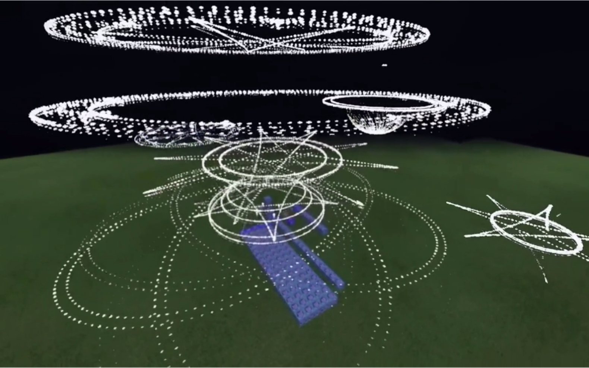 | 三到四层不同倾角的点阵环叠在头顶，环里嵌星形与多边形，中心一个漏斗状旋涡，地面另有大范围虚线环与放射线 | [BV1xb4y1m7yc · Minecraft_OCEAN](https://www.bilibili.com/video/BV1xb4y1m7yc) |
| 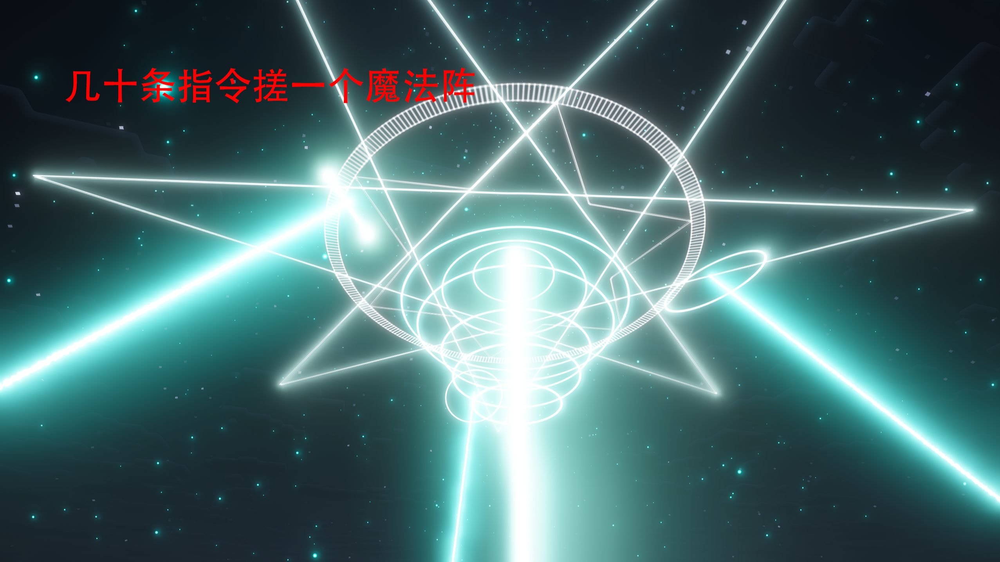 | 双同心环，其中一圈带密集刻度齿；内接五角星出头，下方一串倾斜相交环像陀螺，中心竖直光柱，两侧对角光束，青白高亮（bloom） | [BV1eAJw6mESm · lzxnone](https://www.bilibili.com/video/BV1eAJw6mESm) |
| 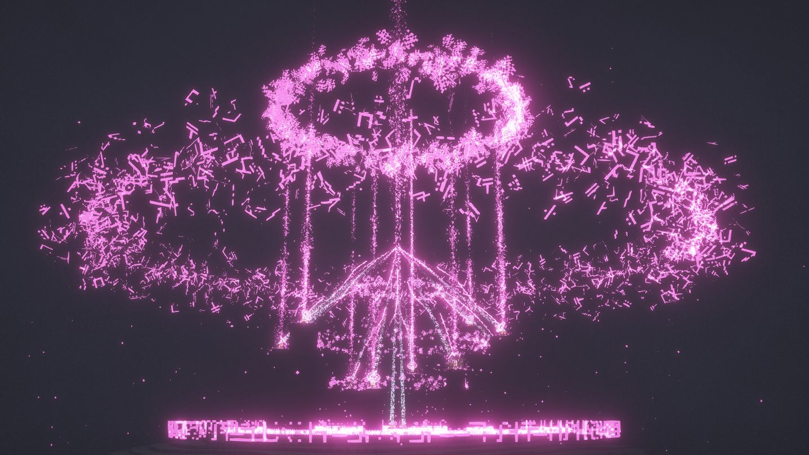 | 两枚悬浮光环 + 环间垂直光线 + 底部一排符文/乱码字符带 + 四散碎片粒子，粉紫单色高饱和 | [BV15trFBbE4v · 空栈不是空伐](https://www.bilibili.com/video/BV15trFBbE4v) |
| 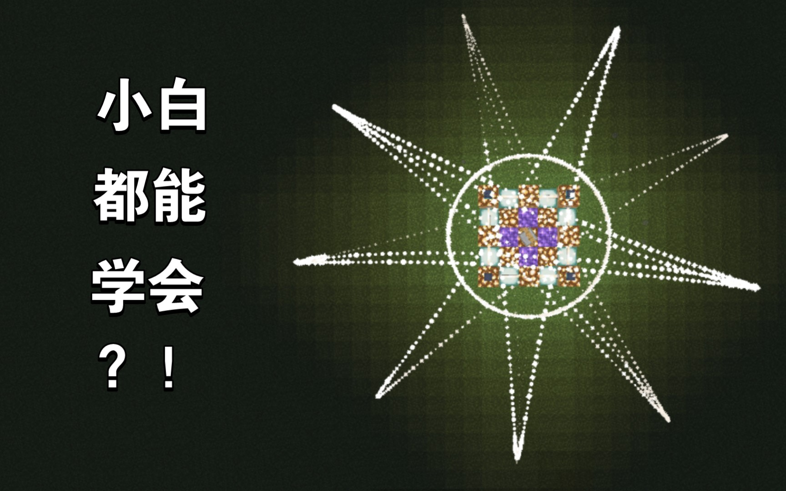 | 地面九根放射尖角 + 一圈细线 + 中心用方块摆出的阵眼（方块本身当图案） | [BV1st4y1V7BZ · 习习渔](https://www.bilibili.com/video/BV1st4y1V7BZ) |
| 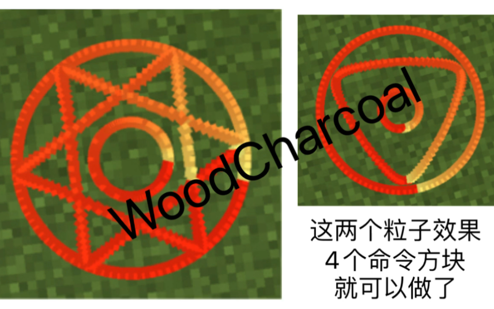 | 左：单圆 + 出头的六芒星 + 内圈小圆，粒子沿角度从红到黄渐变；右：圆 + 圆角三角 + 螺旋尾。作者标注这两个阵 4 个命令方块就够 | [BV1oK411n7Hu · WoodCharcoal](https://www.bilibili.com/video/BV1oK411n7Hu) |
| 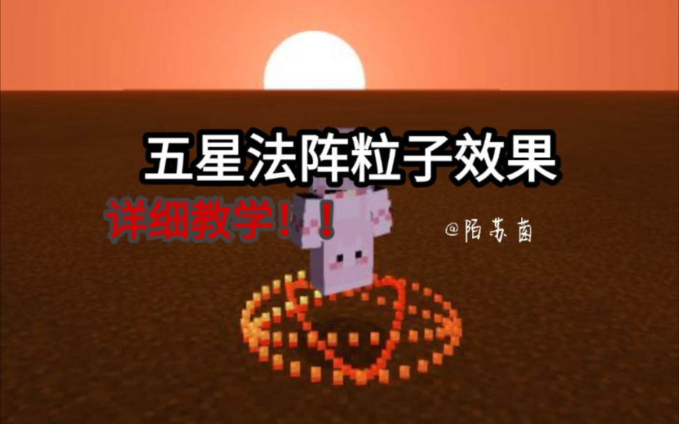 | 脚下双环 + 五角星，橙色，跟随玩家移动 | [BV1JZ4y1M7NN · 鳕苏](https://www.bilibili.com/video/BV1JZ4y1M7NN) |
| 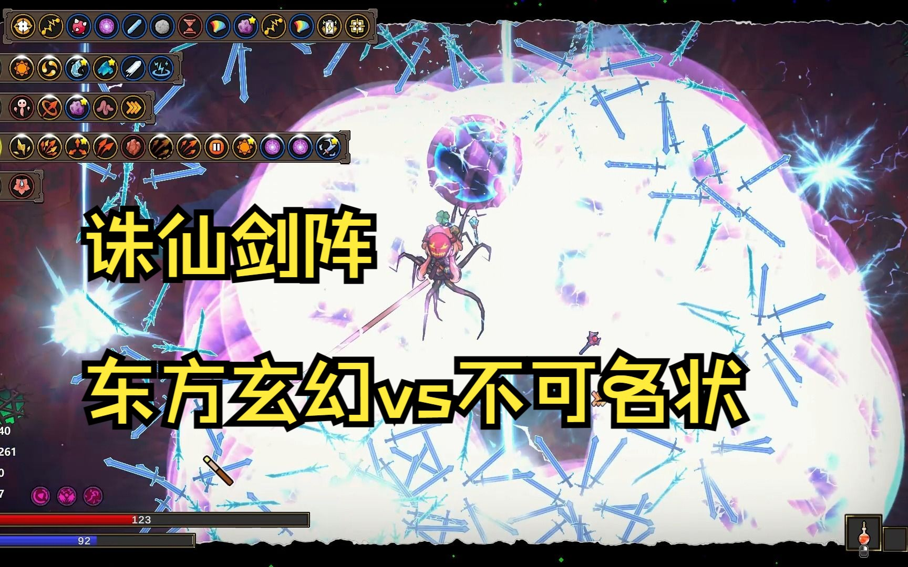 | 球形光罩 + 成环排布的飞剑 + 外圈雷电 + 中心黑洞状球体（魔法工艺模组） | [BV1qG41197Wb · 愚者sama-](https://www.bilibili.com/video/BV1qG41197Wb) |
| 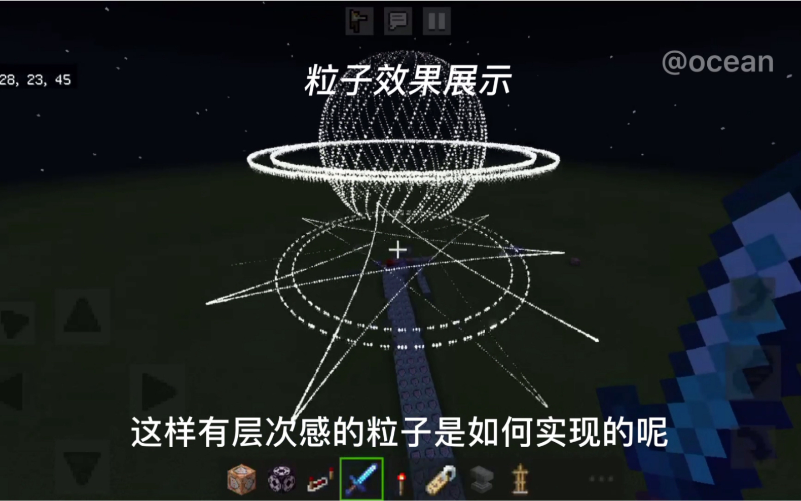 | 经纬线框球 + 赤道环，下方再叠一层地面星阵，形成上下两层信息 | [BV1XN411f7N8 · Minecraft_OCEAN](https://www.bilibili.com/video/BV1XN411f7N8) |
| 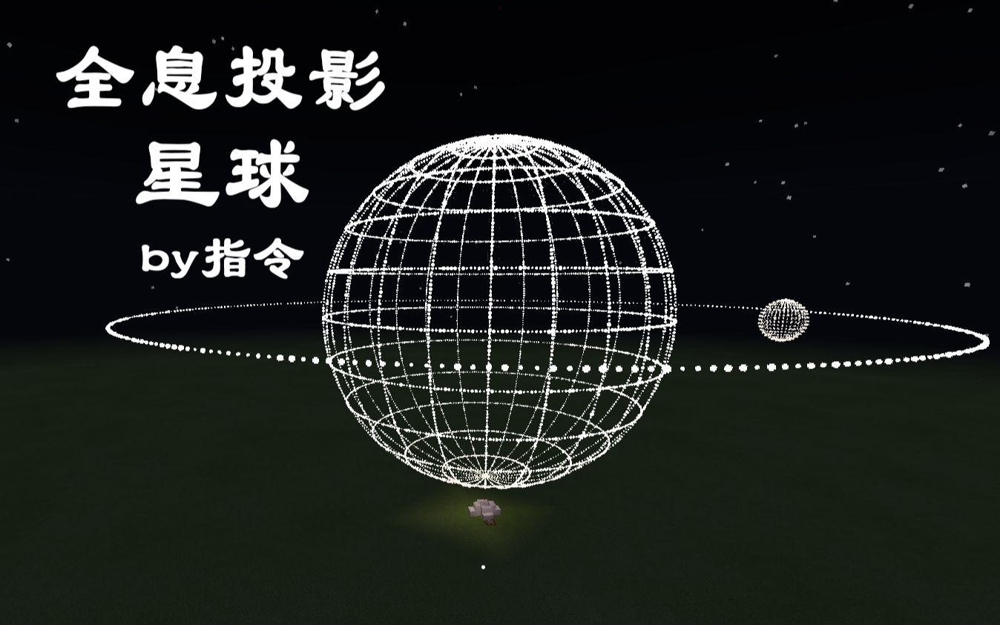 | 纯点阵画的经纬球 + 轨道环 + 一颗小卫星球，示范「只用点也能读出线」 | [BV1sK411F7AH · 红石方块Max](https://www.bilibili.com/video/BV1sK411F7AH) |
| 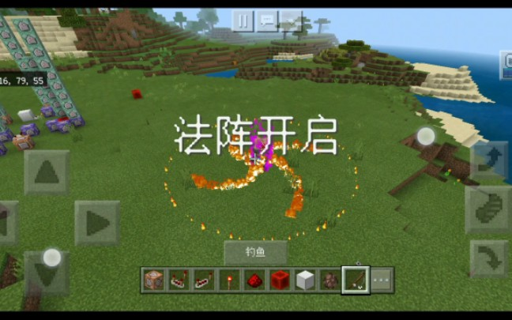 | 地面三段火焰弧 + 橙色粒子环，人物站中心，「法阵开启」的瞬时反馈 | [BV1uE411F7Et · 一只不知所措的史莱姆](https://www.bilibili.com/video/BV1uE411F7Et) |
| 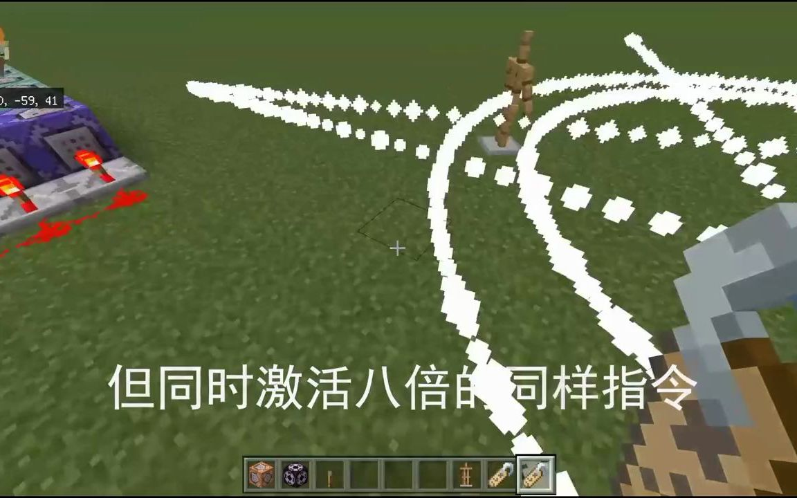 | 生成现场的命令方块、盔甲架与被拖出的白色粒子轨迹——他们靠实体当粒子发射器 | [BV18f4y1Z7or · MinecraftOcean](https://www.bilibili.com/video/BV18f4y1Z7or) |
| 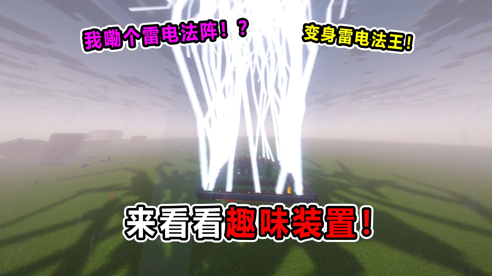 | 多道垂直落雷围成柱状「雷笼」罩住平台，竖向元素撑起体量 | [BV1CZ4r6ZEFB · 山山生存日记](https://www.bilibili.com/video/BV1CZ4r6ZEFB) |

### B. 铁魔法 Iron's Spells 'n Spellbooks（模组参照：施法体系怎么包成可组合的卡）

| 图 | 看到的东西 | 出处 |
|---|---|---|
|  | 法师塔结构、被十字钉起的骷髅、六种颜色的符文/卷轴物品 | [BV1594y1s7WF · 籽岷](https://www.bilibili.com/video/BV1594y1s7WF) |
| 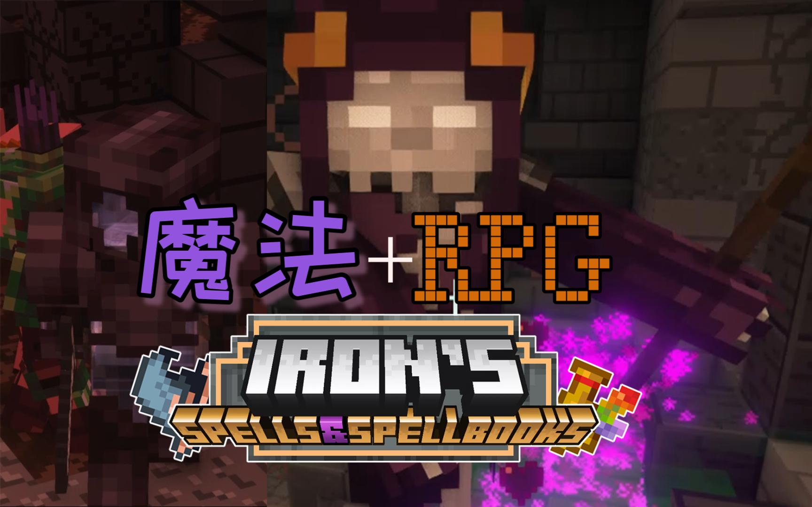 | 标题 logo + 角色在地下施法，紫红色粒子泼洒 | [BV1su411N7vy · Puikre](https://www.bilibili.com/video/BV1su411N7vy) |
| 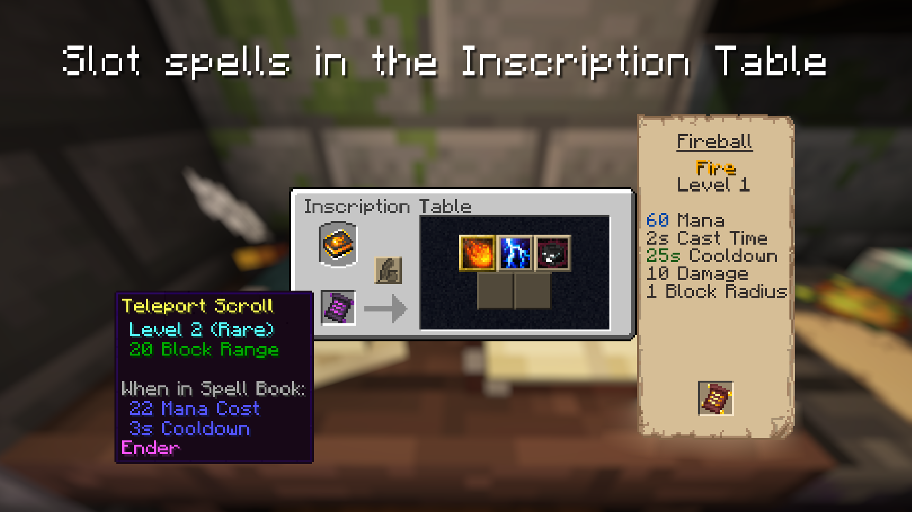 | 官方图：法术按槽位拼进书里，右侧给出该法术的蓝耗/吟唱/冷却/伤害/半径，左侧给出卷轴稀有度与入书后的修正 | [Modrinth 项目页](https://modrinth.com/mod/irons-spells-n-spellbooks) |
| 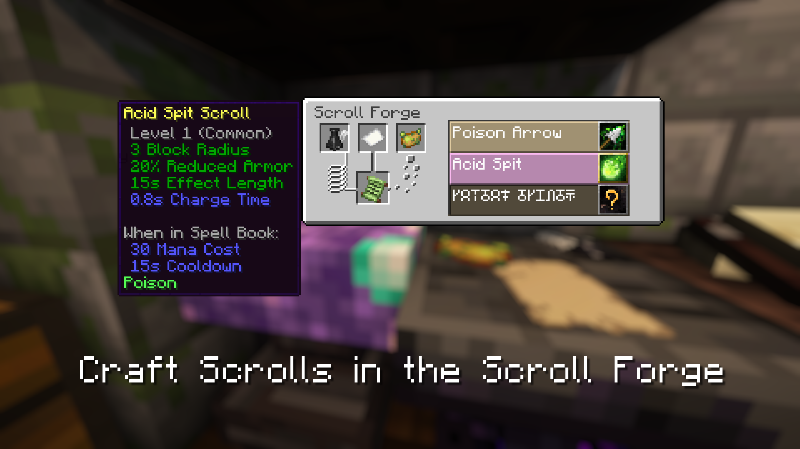 | 官方图：材料合成卷轴，右侧法术列表按稀有度着色，未解锁项名字显示成乱码 | 同上 |
|  | 法师 + 法杖 + 符文书的图标 | 同上 |

### C. 公版结构参考（17 世纪《所罗门小钥匙》印记图，来自 Wikimedia Commons）

| 图 | 看到的东西 |
|---|---|
| 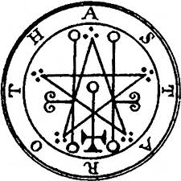 | 外圈字母环 + 内圈几何（星形、竖线、圆点、双十字）——「环内字母 + 内核几何」的经典两件套 |
| 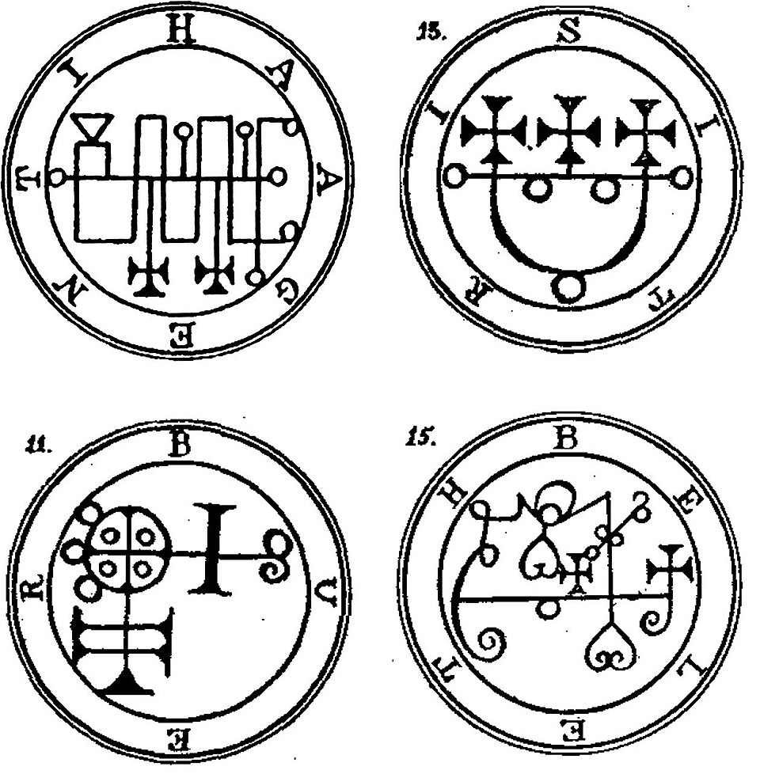 | 同一套语法排出四种性格：字母环 + 不同内核符号，说明辨识度靠内核形状而不是层数 |

## 三、把「炫彩」拆成可实现的分层

看完这批图，一个好看的法阵大致由这几层拼出来，跟层数多少关系不大，跟**每层各转各的**关系最大：

1. **外环**：连续细环、虚线环（点间距均匀）、刻度齿环（像尺子的短刻度）。刻度齿环是「科技感」的主要来源。
2. **放射与尖角**：从圆心出发的直线 spoke，以及出头 / 不出头的星形尖角。出头更显张，不出头更工程感。
3. **内接多边形与星形**：poly-n、{n/2}、{n/3} 星形。不同阵换内核形状即可区分（我们的 poly7 / poly6 / flower / square / triangle 已经是这个思路）。
4. **偏心小圆与小符号**：主环内侧挂几个小圆、小十字、小圆点，或者一圈字母——打破「同心圆的呆板」。公版印记图就是靠这一步出辨识度。
5. **竖向元素**：中心光柱、环间垂线、落雷笼、漏斗/圆锥旋涡。加一层竖向，体量立刻从「地贴」变成「法阵结界」。
6. **顶部悬浮环组**：2–4 圈不同倾角、不同速度、**正反交替**旋转的环，这是 B 站那批指令法阵最抢眼的一点。
7. **环境层**：四散碎片粒子、符文带、把方块摆进阵眼当图案。

配色上有两条规律：**沿角度做双色渐变**（图 05 的红→黄），或**近白核心 + 单层彩色外环**（图 02、03）；亮度靠叠加混合（additive），不是靠调不透明度。

时间轴上，值得抄的反馈分三段：**描线生长**（环按角度依次出现，像被画出来）→ **稳定自旋**（各层异速反转）→ **临期衰减**（先减速再淡出）。我们现在只有 pulse 透明度呼吸，缺 1、3 两段。

## 四、落到本项目怎么改（按分层责任制的口径）

现状：[js/cards.js](../../js/cards.js) 的 G.SIGILS 每条只有单个 shape + color（poly7 / poly6 / flower / square / triangle / circle），[js/main.js](../../js/main.js) 的 `sigilTexture(shape, color)` 画一张共享 canvas 贴图，`buildSigilMesh` 生成单个水平面，[js/battle.js](../../js/battle.js) 的 `addSigil` / `sigilTick` 只管判定与到期，视觉上只有 `setSigilOpacity` 的呼吸。

改法（一条都不越层）：

1. **数据**：G.SIGILS 每条加 `layers` 数组，纯数据描述上面 1–6 层，例如 `{kind:'ticks', r:1.0, n:48, spin:+0.35}`、`{kind:'star', r:0.72, n:6, step:2, spin:-0.5}`、`{kind:'pillars', r:0.9, n:6, h:2.2}`；再给每条加 `ink`（生长时长）与 `tint2`（渐变副色）。cards.js 只加数据，不加逻辑。
2. **渲染**：main.js 把「单贴图单 quad」换成「按 layers 建多份 quad/Points，各自累加 rotation」，材质用 additive blending；贴图缓存键从 `shape+color` 扩成 `layers 指纹`。几何体与材质沿用现在的 dispose 路径（`disposeSigilMesh` 已修过一次没清干净的问题，别退回去）。
3. **状态**：battle.js 只在 sigil 上放判定需要的字段；每层转角是**渲染侧**量，放在 mesh/渲染缓存里按 `dt` 累加，仿照 `rp()/renderPos` 的插值思路，**不要写回权威状态**（存档不存法阵，但一旦写进 sigil 就会污染未来的网络同步与结算一致性）。
4. **三段时间轴**：生长相位用 `age/delay` 算，临期衰减用剩余 ttl 算，都只影响渲染参数。
5. **性能**：按 hgPool 的教训复用 BufferGeometry；量级控制在「6 个法阵在场 × 每阵 ≤4 层 × 每层 ≤128 点」。
6. **门禁**：改完必跑 `node tools/audit.cjs`（三种子）+ `--file` + `node tools/feel_probe.cjs`（碰了渲染位置/粒子）+ `node tools/layer_check.cjs`；交付前 `node tools/audit.cjs --shots /tmp/gwshots` 自己看图。手感类不能只看我这边的绿灯。

建议第一批做 3 个样板给方向定调：陨星阵（火环 + 刻度齿环 + 顶部双环反转）、冰川阵（六角内接 + 竖向冰柱笼）、繁花阵（花瓣环 + 生长描线 + 双色渐变）。这三个覆盖了 A 组里最抢眼的三种套路。

## 五、诚实说明

- 服务器出口访问不到 B 站搜索接口（风控）与 Reddit/Steam 社区/fandom，本轮所有 B 站与铁魔法素材都是经台式机（192.168.2.17，SSH）抓回本地的；台式机只当网络出口，没动它的 GPU 与桌面。
- B 站这批只拿到**视频封面**（封面即 UP 主自己挑的精彩瞬间）；要拿视频内更准的某一帧，需要点进具体 BV 号再抽帧，可以再让我做。
- 铁魔法我只拿到 Modrinth 项目页的 2 张官方功能图（铭文桌、卷轴熔炉）与 logo，项目自带的 6 种法术书/法杖贴图没抓全；它的施法粒子（角色脚下与头顶的阵）本次也没抓到干净截图。
- 图 07、12 这类是模组内特效，作者署名见表格；这些图只用于我们内部的视觉参照，不进入仓库发布物。目录未 git 提交，不要的话说一声我整个移到 `/tmp/`。
