# Noita 民间玩家「炫酷魔法」调研图录

调研时间：2026-10-16（Asia/Shanghai）。图片由本次会话在线抓取，逐张看过内容后配图说明；文字是对画面与出处的自述概括，不是原文摘录。

## 一、这次看到的三种「民间魔法」

Noita 玩家自造魔法大致分三条路子，炫酷的方向各不相同：

1. **不装模组的「魔杖编程」**——只用游戏自带法术卡，把「触发 / 定时 / 失效触发」「一分为 N」「抽取（Draw）」「字符法术（伽马、谬、阿尔法、陶、欧米伽等）」「魔杖刷新」按顺序排进杖内，做出官方没写过的行为：寿命卡到 −1 帧的**永久法术**（社区叫 infiniwisp / wisp）、反复调用同一法术的**递归炮**、靠「饥饿的幽灵」天赋做指数级伤害增幅的**绿幽灵配置**、以及用魔杖刷新把限次法术（黑洞、活力之环）变成无限连发。中文社区的沉淀在 Noita wiki 的「专家攻略」系列页面。
2. **模组作者新增的魔法本身**——有人把泰拉瑞亚的「星辰（Zenith）」剑阵搬进 Noita，有人把惠惠的「Explosion」做成主角技能，有人给材质粒子做出会动的「生命」，还有人重做炼金扩展、加 166 个新敌人与 20 个新 BOSS、或做一个能自由拼装法术与物品的创造菜单。
3. **社区攻略沉淀的「构筑」**——韩国社区攻略站 dood.gg 的 wand tier list 把玩家构筑排了 S–D 级，推荐侧有球状闪电、螺旋魔弹、连环魔弹、多重施放；反面教材写得很直白：**把黑洞当主炮**、把「一分为十」当省蓝手段都是误读（黑洞其实是挖地形与吸物的工具）。

## 二、图录（22 张）

### A. 模组作者新增的魔法与造物（来源 modworkshop.net 的 Noita 分区）

**noitazenith —— 把泰拉瑞亚「星辰」搬进 Noita**（作者 Geo oddball，[mod/58464](https://modworkshop.net/mod/58464)）

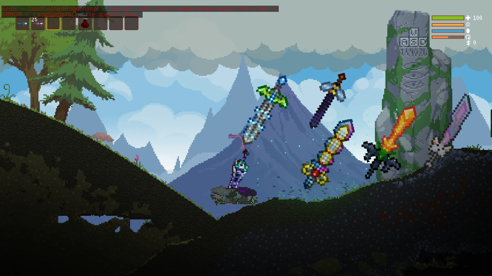
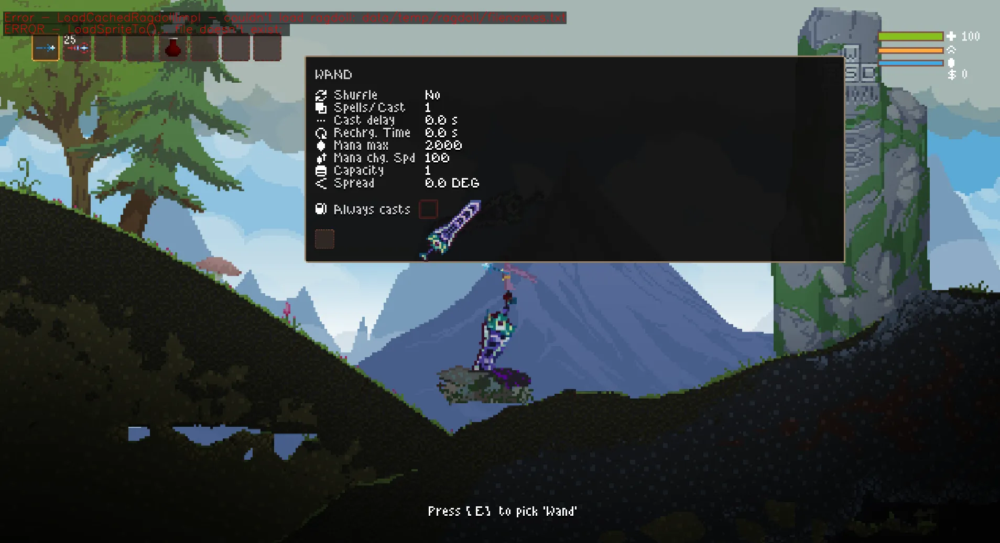

**Play as Megumin —— 惠惠与她的 Explosion**（[mod/25817](https://modworkshop.net/mod/25817)，约 4.9 万下载）

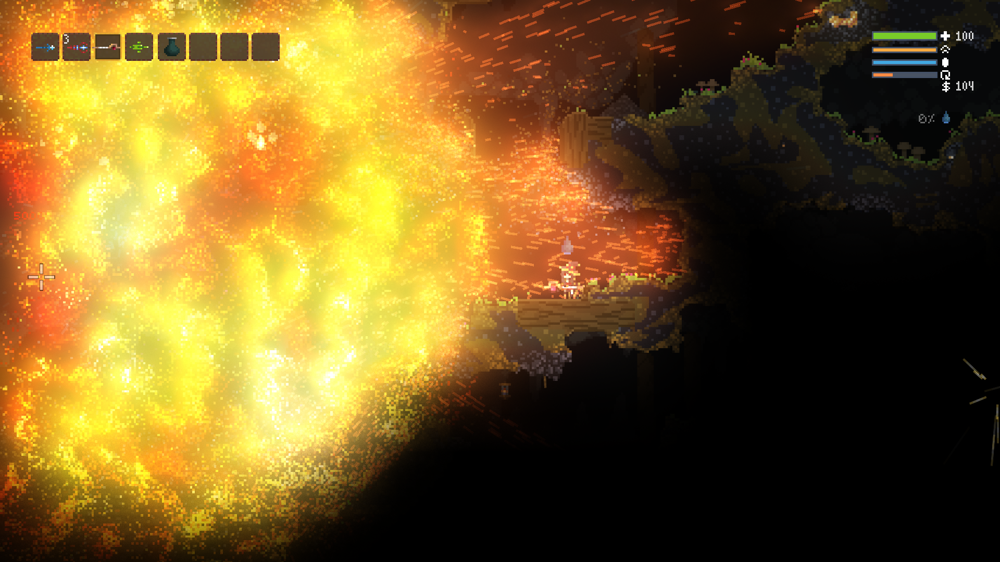
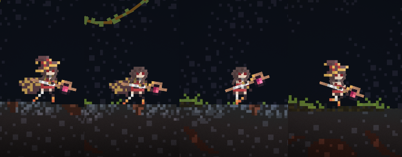

**Metamorph: Creative Menu —— 玩家自造法术的实验室**（[mod/58478](https://modworkshop.net/mod/58478)）

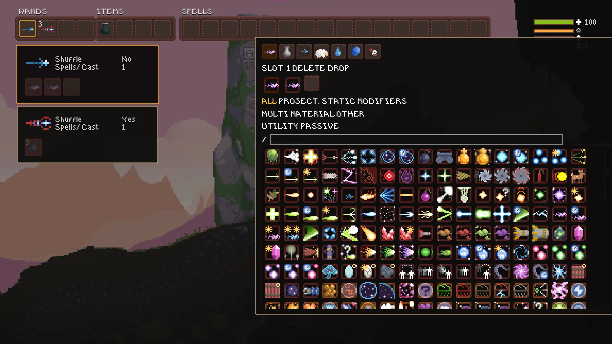
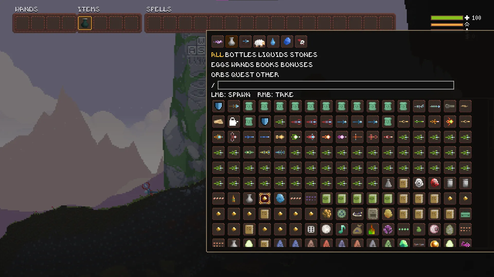

**Conjurer Reborn —— 沙盒 builder 与符纹祭坛**（作者 KagiyamaHina，[mod/58711](https://modworkshop.net/mod/58711)）

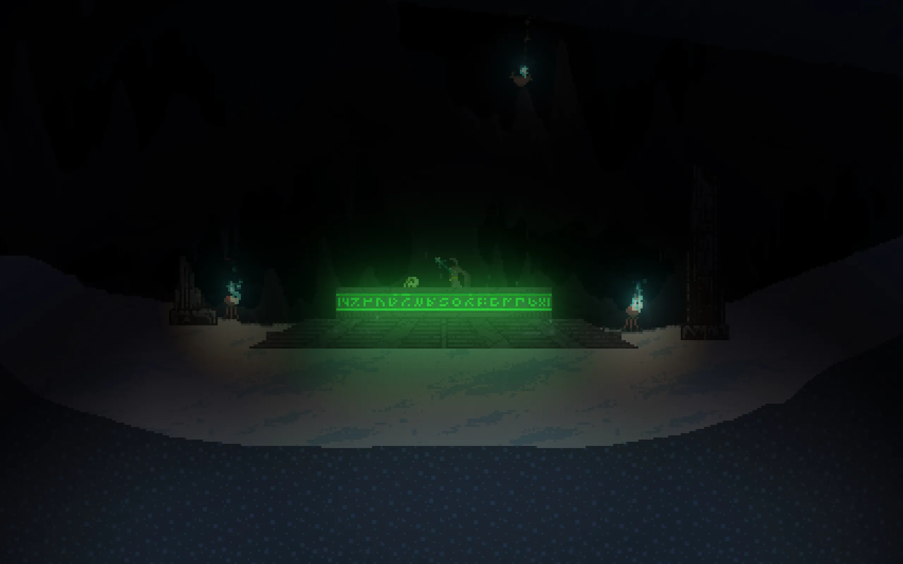

**Keith Sammut 系列：新群系、末日机器、粒子生命**

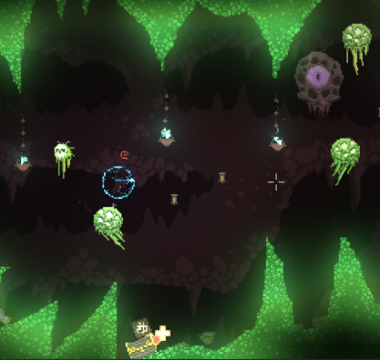 — [New Biomes + Secrets!](https://modworkshop.net/mod/26438)
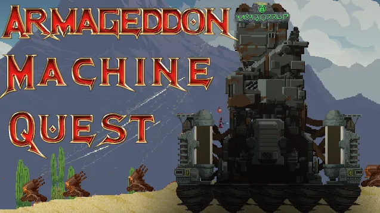 — [Armageddon Machine Quest](https://modworkshop.net/mod/50121)
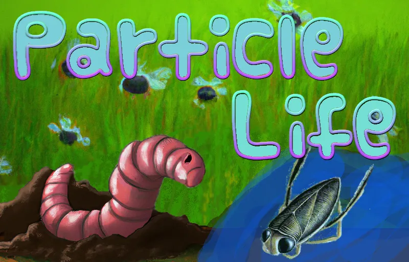 — [Particle Life!](https://modworkshop.net/mod/50125)
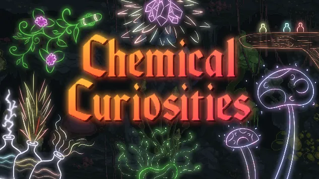 — [Chemical Curiosities](https://modworkshop.net/mod/53590)（Arcane Alchemy 的精神续作）
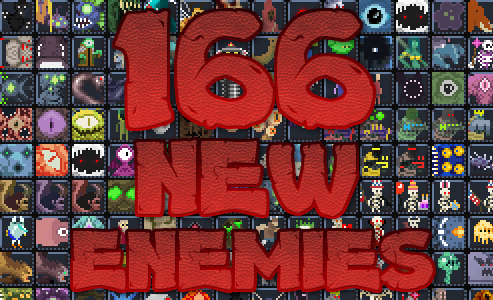 — [New Enemies And Bosses Mod!](https://modworkshop.net/mod/26422)

### B. 魔杖编程与自制法术（来源 Noita wiki 中文镜像 BWIKI）

玩家自制的法术卡动效（[Mod: 图像放射器](https://wiki.biligame.com/noita/Mod:_%E5%9B%BE%E5%83%8F%E6%94%BE%E5%B0%84%E5%99%A8) 教程页）：

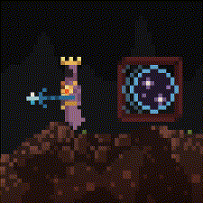
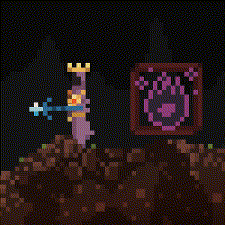
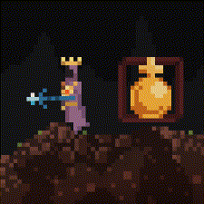

模组效果演示动图：

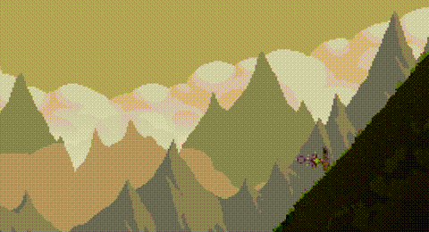
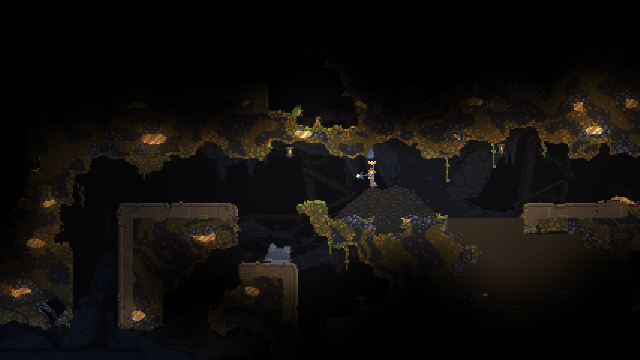

魔杖编程的最小零件「定时 / 触发」（[定时](https://wiki.biligame.com/noita/%E5%AE%9A%E6%97%B6)、[触发](https://wiki.biligame.com/noita/%E8%A7%A6%E5%8F%91)）：

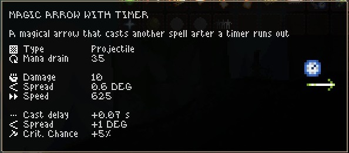
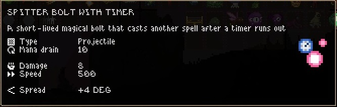
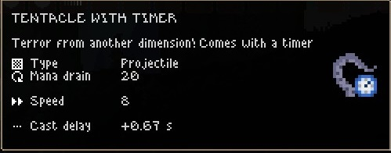

### C. 官方商店截图，仅作氛围对照（[Steam 商店页](https://store.steampowered.com/app/881100/Noita/)）

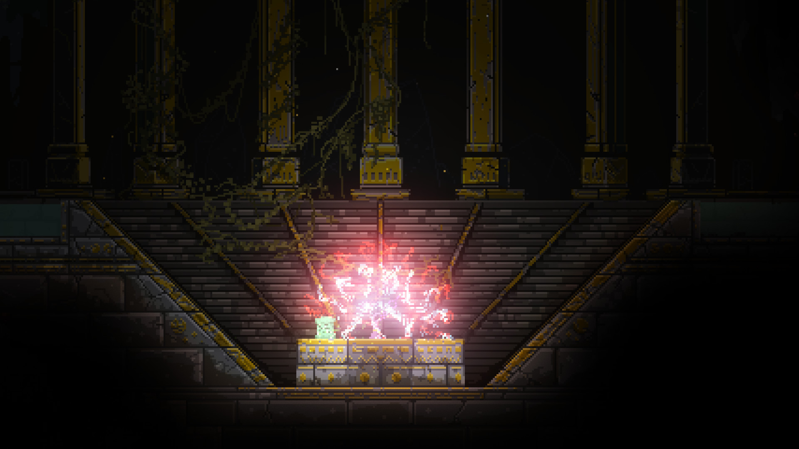
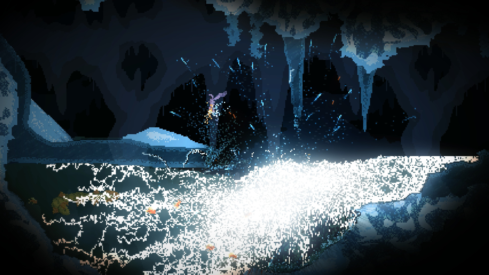

## 三、抓取范围与没拿到的部分（诚实说明）

- 本次机器出口**访问不到** reddit.com、steamcommunity.com、noita.fandom.com、static.fandom.com、imgur.com、i.ytimg.com（全部超时）；**能访问**的是 wiki.biligame.com（Noita 官方 wiki `noita.wiki.gg` 的中文镜像）、modworkshop.net 与其 storage CDN、store.steampowered.com 与 Steam 静态 CDN。所以模组素材取自 modworkshop.net（Noita 分区共 40 个模组，已翻完），魔杖编程词条取自 BWIKI 的「专家攻略 / 触发 / 定时 / 图像放射器」等页面。
- **没取到**：Reddit r/noita 与 Steam 创意工坊的**玩家晒图帖**（网络不可达）、B 站玩家视频封面（`api.bilibili.com` 搜索接口要求登录风控，只返回 v_voucher）、`noita.wiki.gg` 原站高清图（Cloudflare 403）。要补这几类，得换有海外出口的机器或走 MateBook 的校园网出口。
- BWIKI「专家攻略」页面引用的部分图（`终焉之手.png`、`Demo_velocity_wand.png`、`Infini-Wisp_Chart.png`、`跃迁实现效果展示配置.gif`）**未同步**到镜像站，原图在 fandom / wiki.gg 上，本次拿不到，图录里缺席。
- 文件都在本目录，未 git 提交；不想要了说一声，我把整个 `research/noita-magic/` 移到 `/tmp/`。
